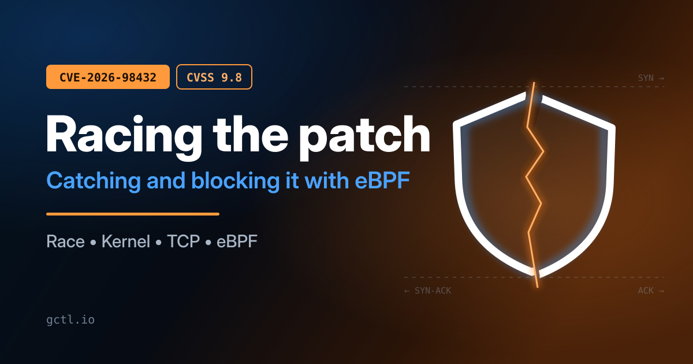
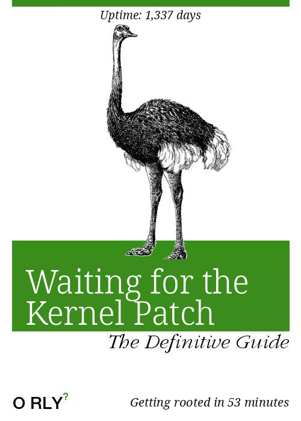

<figure class="post-figure">
  
</figure>

Send the right packets to a Linux server, and in Anthropic's proof of concept you have a root shell fifty-three minutes later. No password, no login, no one clicking anything.

That is **CVE-2026-98432**, a use-after-free in the Linux kernel's IPv4 TCP handshake, [rated 9.8 out of 10](https://nvd.nist.gov/vuln/detail/CVE-2026-98432). On 27 October, Anthropic [showed the exploit](https://www.anthropic.com/research/discovering-vulnerabilities-with-claude) working against servers with a Multipath TCP (MPTCP) listener. The fix is two lines, and it is already in every maintained stable kernel. Your distribution's kernel is another matter: as I write this, Ubuntu's fixed kernels are still ["work in progress"](https://ubuntu.com/security/CVE-2026-98432) on every supported release.

That gap, between "the bug is public" and "my kernel is fixed", is where the danger is, and it is what this post is about: how to **detect** anyone trying the bug, how to **block** it before the patch arrives, why doing that with [eBPF](https://ebpf.io/what-is-ebpf/) earlier in the stack beats a [netfilter](https://www.netfilter.org/) rule in some setups (and where it does not), the other mitigations that matter, and how to patch Ubuntu the moment the update lands.

<div class="terms" markdown="1">

**📖 Terms in this post**

- **Use-after-free (UAF).** Code keeps using memory after it has been freed. If an attacker can get their own data into that memory first, they control what the code reads. ([CWE-416](https://cwe.mitre.org/data/definitions/416.html))
- **RCU.** Read-copy-update: a kernel scheme that lets readers proceed without locks, provided writers wait for a "grace period" before freeing anything a reader might still hold. ([RCU](https://docs.kernel.org/RCU/whatisRCU.html))
- **IP options.** Optional fields at the end of an IPv4 header, such as record-route or timestamps. A header with options is longer than the usual 20 bytes, so its IHL (header length, in 32-bit words) is greater than 5. They are rare on today's internet. ([RFC 7126](https://www.rfc-editor.org/rfc/rfc7126))
- **Request socket.** The small object the kernel creates when a SYN arrives on a listening socket, before the handshake completes. Here it holds `ireq_opt`, a copy of the SYN's IP options. ([`request_sock.h`](https://github.com/torvalds/linux/blob/master/include/net/request_sock.h))
- **MPTCP.** Multipath TCP: one connection spread over several paths. A server uses it only if the application asks for it. ([RFC 8684](https://www.rfc-editor.org/rfc/rfc8684.html) · [mptcp.dev](https://www.mptcp.dev/))
- **XDP.** eXpress Data Path: an eBPF hook in the network driver that sees each packet before the kernel builds its packet structure (`sk_buff`). It can pass, drop or redirect. ([XDP](https://docs.ebpf.io/linux/program-type/BPF_PROG_TYPE_XDP/))
- **tc / netfilter.** Later hooks in the receive path. tc runs eBPF or classifiers on the `sk_buff` ([tc-bpf](https://man7.org/linux/man-pages/man8/tc-bpf.8.html)); netfilter is what nftables and iptables program. ([Netfilter hooks](https://wiki.nftables.org/wiki-nftables/index.php/Netfilter_hooks))
- **BPF LSM.** eBPF programs attached to the kernel's security hooks, which can refuse an operation by returning an error. ([BPF LSM](https://docs.kernel.org/bpf/prog_lsm.html) · [program type](https://docs.ebpf.io/linux/program-type/BPF_PROG_TYPE_LSM/))
- **kprobe.** An eBPF program attached to an arbitrary kernel function. It can read the function's arguments but, in general, cannot change what the function does. ([kprobes](https://docs.kernel.org/trace/kprobes.html) · [program type](https://docs.ebpf.io/linux/program-type/BPF_PROG_TYPE_KPROBE/))

</div>

> Point-in-time (2 November 2026). Ubuntu's status comes from its CVE tracker as last updated on 30 October; check it again before you rely on anything here. I tested on a Linux 7.2: both eBPF programs pass the verifier; the BPF LSM block and the bpftrace tripwire work end to end over loopback; the XDP program detects and drops live traffic in native mode on a veth pair ([testing](#-testing-it-before-you-trust-it)); all four nftables and iptables rules below drop SYNs that carry IP options and let ordinary connections through; and every Go setting below was checked against a real listener with `ss`. Try them on a test host in detect mode before you put them on anything that matters.

## 🐛 The bug, briefly

When a SYN arrives with IPv4 options, the kernel copies those options into the request socket (`ireq->ireq_opt`). When the handshake completes, `tcp_v4_syn_recv_sock()` hands that copy to the new child socket *without* making its own copy. Meanwhile, on another CPU, a retransmitted SYN for the same connection can make the kernel send another SYN-ACK, which reads `ireq_opt` under RCU protection only. Child sockets free their options with a plain `kfree()`, not after an RCU grace period. If the child is torn down at the wrong moment, the SYN-ACK path reads freed memory in `ip_options_build()`. ([CVE record](https://nvd.nist.gov/vuln/detail/CVE-2026-98432))

A few properties matter for everything that follows:

- **It needs IP options on the SYN.** `ireq_opt` is only filled in when the SYN carries options; otherwise it stays empty. ([`tcp_v4_save_options`](https://github.com/torvalds/linux/blob/master/include/net/tcp.h)) That is why every network mitigation below is "drop IPv4 TCP packets with IP options".
- **It is IPv4 only, but that includes IPv4 connections to IPv6 sockets.** The IPv6 handshake copies options instead of sharing them. ([Red Hat Bugzilla](https://bugzilla.redhat.com/show_bug.cgi?id=2553390)) A server listening on `[::]` without `IPV6_V6ONLY`, though, also accepts IPv4 clients, and the kernel hands those connections straight to the vulnerable IPv4 code. ([`tcp_ipv6.c`](https://github.com/torvalds/linux/blob/master/net/ipv6/tcp_ipv6.c)) "It listens on IPv6" is no protection. Those packets are still IPv4 on the wire, so every mitigation below covers them.
- **MPTCP is how it was exploited, not what causes it.** Anthropic's exploit targets servers with an MPTCP listener. Red Hat is explicit that "Multipath TCP is not a required condition for this flaw" and that nodes with MPTCP disabled "remain affected". ([Anthropic](https://www.anthropic.com/research/discovering-vulnerabilities-with-claude) · [Red Hat](https://access.redhat.com/security/vulnerabilities/RHSB-2026-016))
- **Losing the race is cheap.** "A lost race only fails the handshake without crashing the whole system", so an attacker simply retries. The proof of concept needed 48 minutes to leak a kernel pointer and five more to run a command. ([Anthropic](https://www.anthropic.com/research/discovering-vulnerabilities-with-claude)) Retries are good news for a defender: they are noisy.
- **There is a second trigger.** The same problem exists when request sockets are migrated between listeners ([`net.ipv4.tcp_migrate_req=1`](https://docs.kernel.org/networking/ip-sysctl.html), or a [reuseport BPF program](https://docs.ebpf.io/linux/program-type/BPF_PROG_TYPE_SK_REUSEPORT/) that migrates). ([CVE record](https://nvd.nist.gov/vuln/detail/CVE-2026-98432))

The upstream fix changes `kfree()` to `kfree_rcu()` in two destructors, so readers already inside an RCU section finish before the memory goes. The structure involved already had the `rcu_head` that needs. ([`af_inet.c`](https://github.com/torvalds/linux/blob/master/net/ipv4/af_inet.c) · [`tcp_ipv4.c`](https://github.com/torvalds/linux/blob/master/net/ipv4/tcp_ipv4.c) · [`inet_sock.h`](https://github.com/torvalds/linux/blob/master/include/net/inet_sock.h))

## 📨 Following the SYN-ACK through the kernel

The bug lives in the middle packet of the handshake, the SYN-ACK: the only one of the three that the server *sends*. Here is what a Linux server does with it, step by step, from the current kernel source.

<style>
#synack-diagram .note { fill: #f7f4fd !important; stroke: #b9a6e6 !important; }
#synack-diagram .noteText, #synack-diagram .noteText > tspan { fill: #30205a !important; }
</style>
<div class="mermaid" id="synack-diagram">
sequenceDiagram
    participant C as Client
    participant K as Server (Linux kernel)

    C->>K: SYN, possibly carrying IPv4 options
    Note right of K: Request socket created (SYN_RECV)&lt;br/&gt;the SYN's IP options, if any, saved in ireq_opt
    rect rgb(251, 228, 216)
        K->>C: SYN-ACK, built from the request socket&lt;br/&gt;(echoes the SYN's IP options back)
        Note right of K: Retransmit timer started on the request socket
    end
    C->>K: ACK
    Note right of K: Child socket created, request socket freed&lt;br/&gt;connection ESTABLISHED
</div>

*The shaded step is where the bug lives: every SYN-ACK, including one triggered by a retransmitted SYN, is built from the request socket's copy of the options.*

1. **It is built from the request socket.** A SYN does not get a full socket straight away. The kernel creates a lightweight request socket and builds the SYN-ACK from it in `tcp_v4_send_synack()`, which hands `ireq_opt` to `ip_build_and_send_pkt()` inside an RCU read section. ([`tcp_ipv4.c`](https://github.com/torvalds/linux/blob/master/net/ipv4/tcp_ipv4.c)) That is the detail that matters: if the client's SYN carried IP options, the server echoes them back in its SYN-ACK. In an ordinary handshake there are no options, `ireq_opt` is empty, and the SYN-ACK has a plain 20-byte IP header.
2. **Only the request socket is kept.** After sending, the kernel does not keep the packet. It starts a retransmit timer on the request socket and, if no ACK arrives, builds and sends the SYN-ACK again from the same request socket, up to `net.ipv4.tcp_synack_retries` times (5 by default). ([ip-sysctl](https://docs.kernel.org/networking/ip-sysctl.html))
3. **A retransmitted SYN gets an immediate reply.** If the client never saw the SYN-ACK and sends its SYN again, `tcp_check_req()` recognises a "pure retransmitted SYN" for the same request and sends a fresh SYN-ACK at once, subject to a rate limit, through the same code, reading `ireq_opt` again. ([`tcp_minisocks.c`](https://github.com/torvalds/linux/blob/master/net/ipv4/tcp_minisocks.c))
4. **The ACK ends it.** When the client's ACK arrives, `tcp_v4_syn_recv_sock()` creates the real socket for the connection, and the request socket goes away. From then on, nothing on the server refers to the SYN-ACK.

**Where the bug fits.** Steps 3 and 4 can happen at the same moment on two different CPUs. In step 4, the new socket takes over the request socket's options memory rather than copying it: `ireq_opt` simply becomes the new socket's `inet_opt`. If that new socket is closed quickly, the memory is freed straight away with `kfree()`. Meanwhile, on the other CPU, step 3 may still be building a SYN-ACK from that same memory. It is now reading memory that has been freed, and that an attacker may already have refilled. The fix frees it with `kfree_rcu()` instead, which waits until every reader that started before the free, including that SYN-ACK, has finished.

This is also why `tcp_v4_send_synack()` makes a good tripwire, below: every SYN-ACK built for a request that carries options passes through it.

**What each defence in this post does to that SYN-ACK:**

- **Dropping the SYN** (XDP, nftables, iptables): the SYN never reaches TCP, so there is no request socket and no SYN-ACK.
- **The BPF LSM:** the request is refused in `security_inet_conn_request()`, before `tcp_v4_send_synack()` ever runs, so the SYN-ACK is never built.
- **A patched kernel:** the SYN-ACK is built exactly as before, options and all, but the memory it reads cannot be freed underneath it.
- **Ordinary connections:** no options means `ireq_opt` is empty, the SYN-ACK goes out as usual, and the bug is out of reach.

## 🧭 Where you can intercept a SYN

Every mitigation is a choice of *where* on a SYN's path through the kernel to act. In order, for a packet arriving on a NIC:

| # | Point in the receive path | Who can act there | Can block? |
|---|---|---|---|
| 1 | NIC driver, before an `sk_buff` exists | **XDP** (native mode) | ✅ |
| 2 | `sk_buff` built; generic XDP for drivers without native support | XDP (generic mode) | ✅ |
| 3 | Device ingress | **tc** ([`clsact`](https://man7.org/linux/man-pages/man8/tc-bpf.8.html)), **nftables [`netdev` ingress](https://wiki.nftables.org/wiki-nftables/index.php/Nftables_families)** | ✅ |
| 4 | IP layer, before routing | nftables/iptables **prerouting** ([priorities](https://wiki.nftables.org/wiki-nftables/index.php/Netfilter_hooks): defrag −400, raw −300, conntrack −200) | ✅ |
| 5 | After routing: local delivery, or forward to a container | nftables/iptables **input** (Red Hat's rule, −310) or **forward** | ✅ |
| 6 | TCP: request socket created, SYN's options saved | **BPF LSM** `inet_conn_request` | ✅ |
| 7 | SYN-ACK sent (the racing reader) | kprobe on `tcp_v4_send_synack` | ❌ observe only |
| 8 | Final ACK: child socket created (the racing writer) | kprobe on `tcp_v4_syn_recv_sock` | ❌ observe only |

Points 1–5 filter *packets*. Point 6 refuses *connection requests* from inside the TCP code. Points 7 and 8 are where the bug actually happens, and they are where you can see it, but not stop it.

## ⚖️ Why earlier in the stack, and when it does not matter

Red Hat's official mitigation is an nftables rule at the input hook (point 5). It works, and if it fits your setup, use it. Moving the same check to XDP (point 1) buys you five things.

1. **It covers everything behind the NIC.** Netfilter rules belong to one network namespace. Red Hat's rule runs in the host's input chain, so it never sees traffic that is routed onward to a container, and it says as much for OpenShift: rules on a node "act only on traffic traversing that node's host network namespace". ([Red Hat](https://access.redhat.com/security/vulnerabilities/RHSB-2026-016)) Every container shares the host's kernel, so every container listener is vulnerable too. An XDP program on the physical NIC sees every frame the NIC receives, whether it is headed for the host, a Docker bridge, or a [macvlan](https://docs.docker.com/engine/network/drivers/macvlan/) container, before any namespace is chosen.
2. **It is cheaper per packet.** In native mode, XDP drops a packet before the kernel allocates an `sk_buff`, runs conntrack or walks any rules. An attacker racing this bug sends handshakes for tens of minutes. Dropping them at the driver costs almost nothing.
3. **It is independent of your firewall manager.** [Docker](https://docs.docker.com/engine/network/packet-filtering-firewalls/), [ufw](https://help.ubuntu.com/community/UFW), [firewalld](https://firewalld.org/) and configuration-management tools all rewrite netfilter rules. A hand-added table can disappear on the next reload or be ordered behind someone else's. An XDP program is attached to the interface and stays until you detach it.
4. **It tells you who.** A rule counter tells you how many packets matched. An eBPF map can tell you which source addresses sent them, and the same program can switch from counting to dropping with a one-byte map update, no reload.
5. **Attach and detach are atomic.** There is no window during a ruleset reload where the rule is half-applied.

It is not free, and it is not always better.

- **It only sees what arrives on that NIC.** Traffic from one local container to another over a bridge, loopback, and the inner packets of tunnels ([WireGuard](https://www.wireguard.com/), [VXLAN](https://www.rfc-editor.org/rfc/rfc7348)) never pass the physical NIC's XDP hook. A malicious *local* container is out of its reach.
- **You own the parser.** The program below handles plain Ethernet and one VLAN tag. Double tags, or unusual encapsulation, pass straight through.
- **Generic mode loses most of the speed.** If your driver lacks native XDP, the program runs after the `sk_buff` exists. It still runs before netfilter and still covers every namespace, but point 2 above mostly goes away. Common virtual NICs support native mode: virtio-net since 4.10 and Hyper-V's netvsc since 5.6.
- **It is more to build and maintain.** You need [clang](https://clang.llvm.org/) and [bpftool](https://github.com/libbpf/bpftool), the [verifier](https://docs.kernel.org/bpf/verifier.html) can reject code, and fewer people on a team can read eBPF than can read an nft rule.
- **netfilter can be early too.** An nftables `netdev` ingress chain (point 3) runs on the device before routing and before namespaces, close to tc. If the namespace problem is all you care about, that is the low-effort fix; see the [other mitigations](#-other-mitigations) below.

The BPF LSM program (point 6) is a different trade-off again, covered in its own section below.

## 🧮 Which kernels: the bug, and each mitigation

Kernel versions decide two separate things: whether you have the bug at all, and which of the mitigations below your kernel can run.

### Which kernels have the bug

Every kernel from **4.4** onwards, where commit `079096f103fa` introduced the race. The fix is in these stable releases and everything after them on each branch:

| Branch | Fixed in |
|---|---|
| 5.10 | 5.10.272 |
| 5.15 | 5.15.223 |
| 6.1 | 6.1.190 |
| 6.6 | 6.6.159 |
| 6.12 | 6.12.113 |
| 6.18 | 6.18.56 |
| 7.2 | 7.2.10 |
| mainline | 7.3 |

([CVE record](https://cveawg.mitre.org/api/cve/CVE-2026-98432)) Branches that are no longer maintained upstream, such as 4.19 and 5.4, have no upstream fix at all. On those, you depend entirely on your distribution backporting it. Distribution kernels also carry their own version numbers, so for Ubuntu, go by the [package versions](#-patching-ubuntu) below, not the upstream numbers.

### What each mitigation needs

| Mitigation | Minimum kernel | Also needs |
|---|---|---|
| nftables rules (`inet` input or prerouting) | 3.14 | nftables |
| nftables `netdev` ingress rule | 4.2 | nftables |
| iptables `u32` rule | any affected kernel | iptables with the `u32` match |
| XDP guard, generic mode (`xdpgeneric`) | 4.12 | clang, bpftool |
| XDP guard, native mode (`xdpdrv`) | 4.8, if the driver supports it: virtio-net 4.10, ixgbe 4.12, i40e 4.13, ice 5.5, Hyper-V netvsc 5.6, veth 4.19 | clang, bpftool |
| BPF LSM block | 5.7 | `CONFIG_BPF_LSM=y`; `bpf` in the active LSM list; kernel BTF (`/sys/kernel/btf/vmlinux`, 5.4+, `CONFIG_DEBUG_INFO_BTF=y`); a bpftool from kernel 6.2 or later for `autoattach` |
| bpftrace tripwire | 4.1 for kprobes | kernel BTF (5.4+) for the struct casts, or kernel headers |
| `net.mptcp.enabled=0` | 5.6 | none. Older kernels have no MPTCP, so no MPTCP listeners, but they still have the bug |
| `net.ipv4.tcp_migrate_req=0` | 5.14 | none. Older kernels cannot migrate request sockets, so that second trigger does not exist there |

Sources: the feature list in BCC's [kernel-versions.md](https://github.com/iovisor/bcc/blob/master/docs/kernel-versions.md) (kprobes, XDP, generic XDP, driver support, LRU hash maps, BTF, `bpf_probe_read_kernel`, BPF LSM), and the introducing commits for the rest: veth native XDP [`948d4f214fde`](https://github.com/torvalds/linux/commit/948d4f214fde43743c57aae0c708bff44f6345f2) (4.19), BTF in sysfs [`341dfcf8d78e`](https://github.com/torvalds/linux/commit/341dfcf8d78e) (5.4), MPTCP [`f870fa0b5768`](https://github.com/torvalds/linux/commit/f870fa0b5768) (5.6), `tcp_migrate_req` [`f9ac779f881c`](https://github.com/torvalds/linux/commit/f9ac779f881c) (5.14), bpftool `autoattach` [`19526e701ea0`](https://github.com/torvalds/linux/commit/19526e701ea0) (6.2), nftables `inet` [`1d49144c0aaa`](https://github.com/torvalds/linux/commit/1d49144c0aaa) (3.14) and `netdev` [`ed6c4136f157`](https://github.com/torvalds/linux/commit/ed6c4136f157) (4.2).

### What that means on each Ubuntu release

With each release's original (GA) kernel:

| Ubuntu | Kernel | nftables / iptables | XDP guard | BPF LSM | Tripwire | MPTCP sysctl | `tcp_migrate_req` |
|---|---|---|---|---|---|---|---|
| 26.10 | 7.3 | ✅ | ✅ | ✅ | ✅ | ✅ | ✅ |
| 26.04 LTS | 7.0 | ✅ | ✅ | ✅ | ✅ | ✅ | ✅ |
| 24.04 LTS | 6.8 | ✅ | ✅ | ✅ | ✅ | ✅ | ✅ |
| 22.04 LTS | 5.15 | ✅ | ✅ | ✅, but the stock bpftool (5.15) lacks `autoattach` | ✅ | ✅ | ✅ |
| 20.04 LTS | 5.4 | ✅ | ✅ | ❌ needs 5.7 | ✅ if kernel BTF is present | no MPTCP | no migration |
| 18.04 LTS | 4.15 | ✅ | ✅ | ❌ | needs kernel headers | no MPTCP | no migration |
| 16.04 LTS | 4.4 | ✅ | ❌ generic XDP needs 4.12, virtio-net native 4.10 | ❌ | needs kernel headers | no MPTCP | no migration |

HWE kernels move a release up the table: 20.04 with its 5.15 HWE kernel behaves like 22.04, for example. Check what you are actually running:

```sh
uname -r                                                        # kernel version
grep -E 'CONFIG_BPF_LSM|CONFIG_DEBUG_INFO_BTF=' /boot/config-$(uname -r)
cat /sys/kernel/security/lsm                                    # is "bpf" active?
ls /sys/kernel/btf/vmlinux                                      # kernel BTF present?
bpftool prog help 2>&1 | grep -c autoattach                     # 1 means your bpftool has autoattach
```

Before the options, the one most servers are quietly running today:

<figure class="post-figure">
  
  <figcaption>The ostrich strategy: head down, uptime up. Everything below is the alternative. (Parody cover in the style of the O RLY? book-cover meme.)</figcaption>
</figure>

## 🛡️ Block option #1: _XDP guard_, at the driver

This program counts IPv4 TCP packets that carry IP options per source address, and, once you switch it to enforce mode, drops them. It matches the same packets as Red Hat's nftables rule. It keeps its per-source counts in an [LRU hash map](https://docs.kernel.org/bpf/map_hash.html) and its mode in a one-slot [array map](https://docs.kernel.org/bpf/map_array.html), and builds with [libbpf](https://github.com/libbpf/libbpf)'s headers.

```c
// SPDX-License-Identifier: GPL-2.0
// XDP guard for CVE-2026-98432: count, and optionally drop, IPv4 TCP
// packets that carry IP options (IHL > 5), before the kernel allocates
// an skb for them. Mode 0 = detect (count and pass), 1 = enforce (drop).
#include <linux/bpf.h>
#include <linux/if_ether.h>
#include <linux/in.h>
#include <linux/ip.h>
#include <bpf/bpf_helpers.h>
#include <bpf/bpf_endian.h>

struct vlan_hdr {
	__be16 tci;
	__be16 proto;
};

/* Packets with IP options, per source address. */
struct {
	__uint(type, BPF_MAP_TYPE_LRU_HASH);
	__uint(max_entries, 16384);
	__type(key, __u32);	/* IPv4 source, network byte order */
	__type(value, __u64);	/* packets seen */
} ipopt_src SEC(".maps");

/* Single slot: 0 = detect, 1 = enforce. */
struct {
	__uint(type, BPF_MAP_TYPE_ARRAY);
	__uint(max_entries, 1);
	__type(key, __u32);
	__type(value, __u32);
} ipopt_mode SEC(".maps");

SEC("xdp")
int ipopts_guard(struct xdp_md *ctx)
{
	void *data = (void *)(long)ctx->data;
	void *end = (void *)(long)ctx->data_end;
	struct ethhdr *eth = data;
	struct iphdr *ip;
	__u16 proto;
	__u32 key = 0, src, *mode;
	__u64 one = 1, *seen;

	if ((void *)(eth + 1) > end)
		return XDP_PASS;
	proto = eth->h_proto;
	ip = (void *)(eth + 1);

	/* Unwrap one 802.1Q / 802.1ad tag. */
	if (proto == bpf_htons(ETH_P_8021Q) || proto == bpf_htons(ETH_P_8021AD)) {
		struct vlan_hdr *vh = (void *)(eth + 1);

		if ((void *)(vh + 1) > end)
			return XDP_PASS;
		proto = vh->proto;
		ip = (void *)(vh + 1);
	}

	if (proto != bpf_htons(ETH_P_IP) || (void *)(ip + 1) > end)
		return XDP_PASS;
	if (ip->ihl <= 5 || ip->protocol != IPPROTO_TCP)
		return XDP_PASS;

	src = ip->saddr;
	seen = bpf_map_lookup_elem(&ipopt_src, &src);
	if (seen)
		__sync_fetch_and_add(seen, 1);
	else
		bpf_map_update_elem(&ipopt_src, &src, &one, BPF_ANY);

	mode = bpf_map_lookup_elem(&ipopt_mode, &key);
	return (mode && *mode) ? XDP_DROP : XDP_PASS;
}

char LICENSE[] SEC("license") = "GPL";
```

Build, load and attach it. It starts in detect mode, because a fresh array map is all zeroes.

```sh
sudo apt install clang libbpf-dev linux-tools-$(uname -r)   # clang, headers, bpftool
clang -O2 -g -target bpf -c ipopts_guard.bpf.c -o ipopts_guard.bpf.o

sudo bpftool prog load ipopts_guard.bpf.o /sys/fs/bpf/ipopts_guard \
    pinmaps /sys/fs/bpf/ipopts_maps
sudo bpftool net attach xdp pinned /sys/fs/bpf/ipopts_guard dev eth0   # use xdpgeneric if the driver refuses
sudo bpftool net show dev eth0                                         # confirm it is attached
```

Watch it for a while, then switch to enforce:

```sh
# Who has sent IPv4 TCP packets with options (keys are source addresses, network byte order).
sudo bpftool map dump pinned /sys/fs/bpf/ipopts_maps/ipopt_src

# Enforce: drop them from now on.
sudo bpftool map update pinned /sys/fs/bpf/ipopts_maps/ipopt_mode key 0 0 0 0 value 1 0 0 0
```

Remove it once the kernel is patched:

```sh
sudo bpftool net detach xdp dev eth0
sudo rm -r /sys/fs/bpf/ipopts_guard /sys/fs/bpf/ipopts_maps
```

An XDP attachment does not survive a reboot. Since the reboot you are waiting for is the one that installs the fixed kernel, that is usually what you want; if not, wrap the load and attach commands in a small [systemd unit](https://www.freedesktop.org/software/systemd/man/latest/systemd.service.html).

## 🧱 Block option 2: BPF LSM, inside the TCP code

The XDP program filters packets on one NIC. This one refuses the *connection request itself*, from inside the kernel's TCP code, in every network namespace at once.

The hook is `security_inet_conn_request()`. In the IPv4 handshake, the kernel saves the SYN's options into the request socket and then immediately calls this hook. If it returns an error, the request is dropped: no request socket is kept, no SYN-ACK is sent, and the race never starts. ([`tcp_v4_route_req`](https://github.com/torvalds/linux/blob/master/net/ipv4/tcp_ipv4.c) · [`tcp_conn_request`](https://github.com/torvalds/linux/blob/master/net/ipv4/tcp_input.c)) The same hook runs for SYN-cookie connections and for MPTCP subflows, which reuse the TCP request path. ([`syncookies.c`](https://github.com/torvalds/linux/blob/master/net/ipv4/syncookies.c) · [`subflow.c`](https://github.com/torvalds/linux/blob/master/net/mptcp/subflow.c))

```c
// SPDX-License-Identifier: GPL-2.0
// BPF LSM for CVE-2026-98432: refuse TCP connection requests whose SYN
// carries IPv4 options. Runs in security_inet_conn_request(), after the
// kernel has parsed the SYN and before it sends a SYN-ACK, in every
// network namespace.
#include "vmlinux.h"
#include <bpf/bpf_helpers.h>
#include <bpf/bpf_tracing.h>
#include <bpf/bpf_core_read.h>
#include <bpf/bpf_endian.h>

#define ETH_P_IP 0x0800
#define EPERM 1

__u64 refused = 0;	/* requests refused so far */

SEC("lsm/inet_conn_request")
int BPF_PROG(no_ipopts_req, const struct sock *sk, struct sk_buff *skb,
	     struct request_sock *req, int ret)
{
	unsigned char *head;
	__u16 nh;
	__u8 ver_ihl;

	if (ret)		/* an earlier LSM already refused it */
		return ret;
	if (BPF_CORE_READ(skb, protocol) != bpf_htons(ETH_P_IP))
		return 0;

	head = BPF_CORE_READ(skb, head);
	nh = BPF_CORE_READ(skb, network_header);
	if (bpf_probe_read_kernel(&ver_ihl, sizeof(ver_ihl), head + nh))
		return 0;
	if ((ver_ihl & 0x0f) <= 5)
		return 0;

	__sync_fetch_and_add(&refused, 1);
	return -EPERM;
}

char LICENSE[] SEC("license") = "GPL";
```

BPF LSM programs only run if `bpf` is in the kernel's list of [active security modules](https://docs.kernel.org/admin-guide/LSM/index.html). Check first:

```sh
cat /sys/kernel/security/lsm
```

If `bpf` is missing, add it to the end of that list on the [kernel command line](https://docs.kernel.org/admin-guide/kernel-parameters.html) (for example `lsm=landlock,lockdown,yama,integrity,apparmor,bpf`, using *your* current list plus `,bpf`) via `GRUB_CMDLINE_LINUX` in `/etc/default/grub`, run `sudo update-grub`, and reboot. Then generate `vmlinux.h` from the kernel's [BTF](https://docs.kernel.org/bpf/btf.html) type information, build, and load with [`bpftool prog loadall ... autoattach`](https://github.com/libbpf/bpftool/blob/main/docs/bpftool-prog.rst):

```sh
bpftool btf dump file /sys/kernel/btf/vmlinux format c > vmlinux.h
clang -O2 -g -target bpf -D__TARGET_ARCH_x86 -I. -c no_ipopts_req.bpf.c -o no_ipopts_req.bpf.o

sudo bpftool prog loadall no_ipopts_req.bpf.o /sys/fs/bpf/no_ipopts autoattach
sudo bpftool prog show name no_ipopts_req     # note the map id of its .bss
sudo bpftool map dump id <that-id>            # "refused" counter
```

`autoattach` arrived in the bpftool that ships with kernel 6.2. On an older distribution, such as Ubuntu 22.04 whose `linux-tools` bpftool comes from 5.15, either install a newer bpftool from the [standalone releases](https://github.com/libbpf/bpftool/releases) or write a small libbpf loader. The kernel itself only needs 5.7.

To remove it, delete the pinned directory: `sudo rm -r /sys/fs/bpf/no_ipopts`.

What this buys you over XDP and netfilter:

- **Every namespace, including local traffic.** It runs in the TCP code, so it covers host listeners, container listeners, loopback, bridged container-to-container traffic and tunnel traffic alike. Nothing has to pass a particular interface.
- **No packet parsing to get wrong.** By the time this hook runs, the kernel has already found the IP header, whatever VLANs or tunnels it arrived in. The program reads it with [CO-RE](https://nakryiko.com/posts/bpf-core-reference-guide/) helpers (`BPF_CORE_READ`, [`bpf_probe_read_kernel`](https://docs.ebpf.io/linux/helper-function/bpf_probe_read_kernel/)), so the same object file works across kernel versions.
- **Narrow effect.** It refuses only new TCP connection requests whose SYN has IPv4 options. Other packets, including other IP traffic with options, are untouched.

And what it costs:

- **It may need a reboot to enable**, which is exactly what you are trying to avoid. On a kernel where `bpf` is already active, it is the strongest stopgap here.
- **The kernel does more work first.** The SYN has been received, parsed and turned into a request socket before the hook refuses it. For blocking a flood, XDP is cheaper.
- **It cannot help if the options do not come from the packet.** The kernel's own source notes that an LSM can *replace* `ireq_opt` at this hook. ([`syncookies.c`](https://github.com/torvalds/linux/blob/master/net/ipv4/syncookies.c)) On systems that use labelled networking (for example SELinux with [NetLabel/CIPSO](https://docs.kernel.org/netlabel/index.html)), the kernel can attach options to a connection whose SYN had none. No packet filter sees that. This is my reading of why Red Hat says filtering "reduces exposure to this vulnerability but cannot fully prevent it". ([Red Hat](https://access.redhat.com/security/vulnerabilities/RHSB-2026-016)) Default Ubuntu, with [AppArmor](https://apparmor.net/), does not do this.

### Why not just block with a kprobe?

A kprobe on `tcp_v4_syn_recv_sock` sees the exact moment the bug happens, so it is tempting to make it refuse. It cannot. kprobe and fentry programs observe; the helpers that let a probe change a function's result ([`bpf_override_return`](https://docs.ebpf.io/linux/helper-function/bpf_override_return/), and [`fmod_ret`](https://docs.ebpf.io/linux/program-type/BPF_PROG_TYPE_TRACING/) programs) only work on functions on the kernel's error-injection allowlist. ([Error injection](https://docs.kernel.org/fault-injection/fault-injection.html)) The TCP handshake functions are not on it. On my Linux 7.2 kernel, `sudo cat /sys/kernel/debug/error_injection/list` names 1,150 functions, almost all of them system calls. None of the handshake functions this post touches (`tcp_v4_syn_recv_sock`, `tcp_v4_send_synack`, `tcp_conn_request`, `tcp_check_req`, `inet_csk_route_req` and the rest) is among them. The only networking entries are socket system-call entry points such as `socket` and `setsockopt`, and overriding those cannot help: the kernel completes the TCP handshake in its packet-processing path before any application calls `accept()`. The LSM hook above is the supported way to say no at that layer.

## 🔎 Detection: see the attempt, not just the packet

Even if you block at the edge, you want to know if someone is trying. There are three levels of visibility, from cheapest to most specific.

1. **A rule counter.** Red Hat's nftables rule includes `counter`, so `sudo nft list table inet cve_2026_98432` shows how many packets matched. It tells you *how many*, not *who* or *whether they reached TCP*.
2. **The XDP map.** In detect mode, `ipopt_src` gives you packets with IP options per source address, without dropping anything.
3. **A kprobe on the vulnerable read.** This is the one only eBPF can do. `tcp_v4_send_synack()` is one of the two functions the CVE description names as reading `ireq_opt` in the race. ([NVD](https://nvd.nist.gov/vuln/detail/CVE-2026-98432)) It runs for every SYN-ACK, including the ones triggered by retransmitted SYNs. If it fires for a request that carries IP options, a SYN with options reached the vulnerable code. If the same source keeps showing up, it is retransmitting to win the race.

Here it is as a [bpftrace](https://github.com/bpftrace/bpftrace) one-liner (save
it as `tripwire.bt`):

```c
// tripwire.bt
// CVE-2026-98432 tripwire: a SYN-ACK is being sent for a connection
// request whose SYN carried IPv4 options. tcp_v4_send_synack() is one of
// the two sides of the race; a source that repeats is retrying it.
kprobe:tcp_v4_send_synack
{
	$ireq = (struct inet_request_sock *)arg3;     // 4th argument: req
	if ($ireq->ireq_opt != 0) {
		$src = ntop($ireq->req.__req_common.skc_daddr);
		@synack_with_ipopts[$src] = count();
		printf("%s SYN-ACK to %s for a SYN with IPv4 options\n",
		       strftime("%H:%M:%S", nsecs), $src);
	}
}
```

On a normal server this prints nothing: legitimate clients almost never send IP options, and many networks drop them on the way. ([RFC 7126](https://www.rfc-editor.org/rfc/rfc7126)) Leave it running in a [`tmux`](https://github.com/tmux/tmux) session until you have patched, or feed its output to your alerting.

Two notes. The tripwire only fires for packets that got past your filters, so run it alongside the XDP program in *detect* mode, or after you have enforced, as a check that nothing slips through. And `tcp_v4_send_synack` is a static function. The kernel calls it through a function pointer, so the compiler cannot inline it away, but confirm with `grep -w tcp_v4_send_synack /proc/kallsyms` before relying on it.

## 🧪 Testing it before you trust it

Five kinds of check back this post, each in its own subsection below. All of them ran on a Linux 7.2.

1. [Do the programs load?](#1-do-the-programs-load) The verifier accepts both eBPF programs.
2. [The BPF LSM block and the tripwire, over loopback.](#2-the-bpf-lsm-block-and-the-tripwire-over-loopback)
3. [The XDP guard, on a veth pair.](#3-the-xdp-guard-on-a-veth-pair)
4. [The nftables and iptables rules, in a private namespace.](#4-the-nftables-and-iptables-rules-in-a-private-namespace)
5. [MPTCP off, and the Go settings.](#5-mptcp-off-and-the-go-settings)

Tests 2 and 3 need a way to send a SYN that carries an IP option. [hping3](https://github.com/antirez/hping)'s `--rroute` flag adds the record-route option, which makes the IPv4 header longer than 20 bytes, exactly what the bug needs. Tests 4 and 5 run inside a throwaway user and network namespace ([`unshare -rn`](https://man7.org/linux/man-pages/man1/unshare.1.html)), which gives you real `CAP_NET_ADMIN` over a private network stack without root, so the rules go into the actual kernel and nothing on the host changes.

### 1. Do the programs load?

The quickest check, and the first one to run on any new kernel. It loads each program, which runs the verifier, then removes it without attaching anything. No output means success:

```sh
sudo bpftrace --dry-run tripwire.bt
sudo bpftool prog load ipopts_guard.bpf.o /sys/fs/bpf/t_xdp && sudo rm /sys/fs/bpf/t_xdp
sudo bpftool prog loadall no_ipopts_req.bpf.o /sys/fs/bpf/t_lsm && sudo rm -r /sys/fs/bpf/t_lsm
```

### 2. The BPF LSM block and the tripwire, over loopback

Both work inside the TCP code rather than on a particular interface, so one machine and loopback are enough. Run the tripwire in one terminal:

```sh
sudo bpftrace tripwire.bt        # the bpftrace script above, saved to a file
```

And the test in another:

```sh
nc -l 8080 &                                                        # a listener

sudo hping3 -S -p 8080 -c 3 --rroute 127.0.0.1                      # 1. SYN with IP options, no block
sudo bpftool prog loadall no_ipopts_req.bpf.o /sys/fs/bpf/t_lsm autoattach
sudo hping3 -S -p 8080 -c 3 --rroute 127.0.0.1                      # 2. SYN with IP options, blocked
sudo hping3 -S -p 8080 -c 3 127.0.0.1                               # 3. ordinary SYN, program still loaded

sudo rm -r /sys/fs/bpf/t_lsm; kill %1                               # clean up
```

What I saw on a Linux 7.2, trimmed:

```text
# 1. SYN with IP options, no block: the kernel answers with SYN-ACKs
len=84 ip=127.0.0.1 ttl=64 DF id=0 sport=8080 flags=SA seq=0 win=65495 rtt=0.9 ms
len=84 ip=127.0.0.1 ttl=64 DF id=0 sport=8080 flags=SA seq=1 win=65495 rtt=0.9 ms
len=84 ip=127.0.0.1 ttl=64 DF id=0 sport=8080 flags=SA seq=2 win=65495 rtt=0.8 ms
3 packets tramitted, 3 packets received, 0% packet loss

# 2. With the BPF LSM loaded: the request is refused, no SYN-ACK is sent
3 packets tramitted, 0 packets received, 100% packet loss

# 3. Ordinary SYN with the program still loaded: unaffected
len=44 ip=127.0.0.1 ttl=64 DF id=0 sport=8080 flags=SA seq=0 win=65495 rtt=0.4 ms
len=44 ip=127.0.0.1 ttl=64 DF id=0 sport=8080 flags=SA seq=1 win=65495 rtt=0.3 ms
len=44 ip=127.0.0.1 ttl=64 DF id=0 sport=8080 flags=SA seq=2 win=65495 rtt=0.3 ms
3 packets tramitted, 3 packets received, 0% packet loss
```

(`tramitted` is hping3's own spelling.) Meanwhile the tripwire reported the three SYN-ACKs from step 1, and nothing for steps 2 and 3:

```text
Attached 1 probe
06:53:54 SYN-ACK to 127.0.0.1 for a SYN with IPv4 options
06:53:55 SYN-ACK to 127.0.0.1 for a SYN with IPv4 options
06:53:56 SYN-ACK to 127.0.0.1 for a SYN with IPv4 options
```

That is the whole story in miniature: the replies in step 1 are 84 bytes instead of 44 because the kernel echoes the options back, which is the copy of `ireq_opt` the bug is about; the LSM stops the request before any SYN-ACK exists; and ordinary connections never notice.

### 3. The XDP guard, on a veth pair

This looks as if it needs two machines, because loopback traffic never reaches a NIC's XDP hook. It does not: a [veth](https://man7.org/linux/man-pages/man4/veth.4.html) pair between your main network namespace and a throwaway one behaves like a cable between two hosts, and the veth driver supports native XDP, so the program runs on a real driver hook. This uses exactly the commands from the XDP section above:

```sh
# A veth "cable": veth-host stays here, veth-peer goes into namespace "client".
sudo ip netns add client
sudo ip link add veth-host type veth peer name veth-peer
sudo ip link set veth-peer netns client
sudo ip addr add 10.99.0.1/24 dev veth-host && sudo ip link set veth-host up
sudo ip -n client addr add 10.99.0.2/24 dev veth-peer && sudo ip -n client link set veth-peer up
nc -l 8080 &                                                        # listener on the host side

sudo bpftool prog load ipopts_guard.bpf.o /sys/fs/bpf/ipopts_guard pinmaps /sys/fs/bpf/ipopts_maps
sudo bpftool net attach xdpdrv pinned /sys/fs/bpf/ipopts_guard dev veth-host   # native mode

sudo ip netns exec client hping3 -S -p 8080 -c 3 --rroute 10.99.0.1   # 1. detect mode, SYN with options
sudo bpftool map dump pinned /sys/fs/bpf/ipopts_maps/ipopt_src
sudo bpftool map update pinned /sys/fs/bpf/ipopts_maps/ipopt_mode key 0 0 0 0 value 1 0 0 0
sudo ip netns exec client hping3 -S -p 8080 -c 3 --rroute 10.99.0.1   # 2. enforce mode, SYN with options
sudo ip netns exec client hping3 -S -p 8080 -c 3 10.99.0.1            # 3. enforce mode, ordinary SYN
sudo bpftool map dump pinned /sys/fs/bpf/ipopts_maps/ipopt_src

sudo bpftool net detach xdpdrv dev veth-host                         # clean up
sudo rm -r /sys/fs/bpf/ipopts_guard /sys/fs/bpf/ipopts_maps
sudo ip link del veth-host; sudo ip netns del client; kill %1
```

What I saw, trimmed:

```text
$ sudo bpftool net show dev veth-host
xdp:
veth-host(20) driver id 758

# 1. Detect mode: SYNs with options pass and are counted
len=84 ip=10.99.0.1 ttl=64 DF id=0 sport=8080 flags=SA seq=0 win=64240 rtt=0.5 ms
len=84 ip=10.99.0.1 ttl=64 DF id=0 sport=8080 flags=SA seq=1 win=64240 rtt=0.4 ms
len=84 ip=10.99.0.1 ttl=64 DF id=0 sport=8080 flags=SA seq=2 win=64240 rtt=0.3 ms
3 packets tramitted, 3 packets received, 0% packet loss
[{ "key": 33579786, "value": 6 }]

# 2. Enforce mode: SYNs with options are dropped at the driver
3 packets tramitted, 0 packets received, 100% packet loss

# 3. Enforce mode: ordinary SYNs are untouched
len=44 ip=10.99.0.1 ttl=64 DF id=0 sport=8080 flags=SA seq=0 win=64240 rtt=0.7 ms
len=44 ip=10.99.0.1 ttl=64 DF id=0 sport=8080 flags=SA seq=1 win=64240 rtt=0.6 ms
len=44 ip=10.99.0.1 ttl=64 DF id=0 sport=8080 flags=SA seq=2 win=64240 rtt=0.5 ms
3 packets tramitted, 3 packets received, 0% packet loss
[{ "key": 33579786, "value": 9 }]
```

`driver` in the `bpftool net show` output confirms native mode, not generic. The map key is the source address as bpftool prints a 32-bit integer on a little-endian machine: 33579786 is `0x0200630a`, whose bytes in memory are `0a 63 00 02`, or 10.99.0.2.

The counts are worth a second look, because they are 6 and 9, not 3 and 6. Step 1 counted six packets for three SYNs. The other three are the client kernel's own RSTs: hping3 sends from a raw socket, so when the SYN-ACK arrives the client kernel has no socket for it and answers with a reset, and `tcp_v4_send_reset()` echoes the IP options of the packet it is answering. ([`tcp_ipv4.c`](https://github.com/torvalds/linux/blob/master/net/ipv4/tcp_ipv4.c)) Those RSTs carry options too, so the program counts them. Step 2 added three more: in enforce mode the program counts a packet before it drops it. Step 3 added nothing, because ordinary SYNs have no options. In production, expect the map to count every option-bearing packet from a source, not only its SYNs.

### 4. The nftables and iptables rules, in a private namespace

Each rule is loaded into a private namespace, then a small Python client tries to connect to a local listener twice: once with IP options on its SYN, set with [`setsockopt(IP_OPTIONS)`](https://man7.org/linux/man-pages/man7/ip.7.html) (the same record-route option hping3 uses), and once without. Save the three nftables rules from [Other mitigations](#-other-mitigations) as `redhat.nft`, `pre.nft` and `ingress.nft` (with `device "lo"`, since a new namespace only has loopback), and the client as `conntest.py`:

```python
import socket, sys, threading

# Record-route option: type 7, length 39, pointer 4, nine empty slots, then EOL: 40 bytes.
RR = bytes([7, 39, 4]) + bytes(36) + b"\x00"

srv = socket.socket()
srv.setsockopt(socket.SOL_SOCKET, socket.SO_REUSEADDR, 1)
srv.bind(("127.0.0.1", 8080))
srv.listen(16)
threading.Thread(target=lambda: [srv.accept()[0].close() for _ in iter(int, 1)], daemon=True).start()

def attempt(with_options):
    c = socket.socket()
    c.settimeout(2)
    if with_options:
        c.setsockopt(socket.IPPROTO_IP, socket.IP_OPTIONS, RR)
    try:
        c.connect(("127.0.0.1", 8080))
        return "connected"
    except OSError as e:
        return f"blocked ({type(e).__name__})"
    finally:
        c.close()

print(f"{sys.argv[1]:<20} with IP options: {attempt(True):<24} without: {attempt(False)}")
```

Then, with no root needed:

```sh
unshare -rn sh -c '
  ip link set lo up
  python3 conntest.py "no rule"
  for f in redhat.nft pre.nft ingress.nft; do
    nft --file $f; python3 conntest.py $f; nft flush ruleset
  done
  iptables -t raw -I PREROUTING -p tcp -m u32 --u32 "0>>24&0xF=6:15" -j DROP
  python3 conntest.py "iptables u32"'
```

What I saw:

```text
no rule              with IP options: connected                without: connected
redhat.nft           with IP options: blocked (TimeoutError)   without: connected
pre.nft              with IP options: blocked (TimeoutError)   without: connected
ingress.nft          with IP options: blocked (TimeoutError)   without: connected
iptables u32         with IP options: blocked (TimeoutError)   without: connected
```

Every rule drops the SYN that carries options, so the connection times out, and lets the ordinary one through. Each rule's counter read 2 afterwards: the original SYN and one retransmission before the client gave up.

### 5. MPTCP off, and the Go settings

First, `net.mptcp.enabled=0`, again in a private namespace. A new namespace starts with MPTCP enabled, which is exactly the situation inside a container. Turning it off makes an MPTCP-capable listener fall back to plain TCP, and it keeps accepting connections. The output below is from a Go listener (MPTCP on by default) started in the namespace before and after the change; `mptcp=` and `tcp=` count matching lines in `ss -Mln` and `ss -tln`:

```text
net.mptcp.enabled in new netns: 1
enabled=1 (namespace default)      mptcp=1 tcp=1
set net.mptcp.enabled=0: ok
enabled=0                          mptcp=0 tcp=1
connect to fallback listener: ok
host netns still: net.mptcp.enabled=1
```

An MPTCP listener shows up in `ss -t` as well as `ss -M`, because it holds an ordinary TCP listening socket underneath. That is why the check for MPTCP is `ss -Mln` and not `ss -Mlnt`.

Then the Go settings. A minimal Go 1.27 server listens with `net.ListenConfig`, and `ss -Mln` shows whether its port is an MPTCP listener. It runs once per setting from the [Go section](#-other-mitigations) above, including deliberately conflicting ones to check which wins:

```text
default (go 1.27 in go.mod)              MPTCP listener
GODEBUG=multipathtcp=0 env               plain TCP
//go:debug multipathtcp=0                plain TCP
go.mod: godebug multipathtcp=0           plain TCP
SetMultipathTCP(false)                   plain TCP
go.mod says go 1.23 (new toolchain)      plain TCP
env GODEBUG=2 overrides //go:debug=0     MPTCP listener
SetMultipathTCP(false) beats GODEBUG=2   plain TCP
```

And `go list -f '{{.DefaultGODEBUG}}'` reported `multipathtcp=0` for the `go.mod`, `//go:debug` and `go 1.23` modules, and nothing for the default one, exactly as it should.

## 🧰 Other mitigations

None of these need eBPF, and most are worth doing regardless.

**Red Hat's nftables rule.** The official stopgap, dropping IPv4 TCP packets with IP options at the input hook. It does not touch TCP options, which is where MSS, window scaling, SACK, timestamps and MPTCP itself are signalled, so ordinary connections, and MPTCP connections, carry on as before:

```nft
table inet cve_2026_98432 {
    chain input {
        type filter hook input priority -310; policy accept;
        ip protocol tcp ip hdrlength > 5 counter drop
    }
}
```

Load it with [`nft`](https://www.netfilter.org/projects/nftables/manpage.html):

```sh
sudo nft --check --file cve-2026-98432.nft && sudo nft --file cve-2026-98432.nft
sudo nft delete table inet cve_2026_98432     # once patched
```

([Red Hat](https://access.redhat.com/security/vulnerabilities/RHSB-2026-016))

**The same rule, earlier, if you run containers.** The input hook misses traffic forwarded to containers. Two variants cover it. These are my adaptations, not Red Hat's. Prerouting, which still runs in the host namespace but before the forward-or-deliver decision:

```nft
table inet cve_2026_98432_pre {
    chain prerouting {
        type filter hook prerouting priority -310; policy accept;
        ip protocol tcp ip hdrlength > 5 counter drop
    }
}
```

Or the `netdev` ingress hook, on the device itself, which is the nftables equivalent of tc:

```nft
table netdev cve_2026_98432_ingress {
    chain ingress {
        type filter hook ingress device "eth0" priority -500; policy accept;
        ip protocol tcp ip hdrlength > 5 counter drop
    }
}
```

**iptables, if that is what you have.** There is no built-in header-length match, but the [`u32` match](https://ipset.netfilter.org/iptables-extensions.man.html) can read the IHL nibble:

```sh
sudo iptables -t raw -I PREROUTING -p tcp -m u32 --u32 "0>>24&0xF=6:15" -j DROP
```

**Shrink who can reach your listeners.** The bug is pre-authentication, so the most effective mitigation is not letting strangers complete a handshake at all: allowlist source addresses for SSH and admin ports, and put public services behind a proxy or CDN so only its addresses can reach the origin. Red Hat and others list restricting access to trusted networks as the main interim step. ([BleepingComputer](https://www.bleepingcomputer.com/news/security/critical-linux-kernel-flaw-allows-remote-root-attacks-on-mptcp-servers/))

**Turn MPTCP off where you do not use it.** It removes the demonstrated exploit path, though not the bug. The same goes for kernels built without MPTCP at all (no `net.mptcp.enabled` sysctl): they cannot have an MPTCP listener, but the use-after-free is in the ordinary IPv4 TCP code, so they still need the fix.

List MPTCP listeners with [`ss`](https://man7.org/linux/man-pages/man8/ss.8.html), then switch MPTCP off and make it persist with a [`sysctl.d`](https://man7.org/linux/man-pages/man5/sysctl.d.5.html) file:

```sh
ss -Mln                                    # MPTCP listening sockets only; adding -t would list plain TCP too
sudo sysctl -w net.mptcp.enabled=0         # this network namespace only
echo 'net.mptcp.enabled = 0' | sudo tee /etc/sysctl.d/90-no-mptcp.conf
```

`net.mptcp.enabled` is per network namespace, so a container has its own copy, set to 1 by default. ([MPTCP sysctl](https://docs.kernel.org/networking/mptcp-sysctl.html)) In Docker Compose, use the service's [`sysctls`](https://docs.docker.com/reference/compose-file/services/) key:

```yaml
services:
  app:
    sysctls:
      net.mptcp.enabled: 0
```

**Go services deserve their own check.** Since Go 1.24, `net.Listen` and `ListenConfig` use MPTCP by default on Linux when the kernel supports it, so a Go service can be an MPTCP listener without anyone deciding that. ([Go 1.24 release notes](https://go.dev/doc/go1.24)) The behaviour is controlled by the `multipathtcp` GODEBUG setting: `0` turns MPTCP off for listeners and dialers, which is the pre-1.24 behaviour; `2`, the Go 1.24 default, turns it on for listeners only. ([GODEBUG](https://go.dev/doc/godebug))

Which default a binary gets depends on the `go` line in its main module's `go.mod`, not just the toolchain that built it: a program whose `go.mod` says `go 1.23` keeps MPTCP off even when built with a newer Go. To see what a main package will default to:


```sh
go list -f '{{.DefaultGODEBUG}}' ./cmd/myservice   # only differences from the toolchain default are shown
```


There are four ways to turn it off, from quickest to most permanent.

1. **At run time, no rebuild.** Set the environment variable for the service, for example with a systemd [`Environment=`](https://www.freedesktop.org/software/systemd/man/latest/systemd.exec.html) override. It takes precedence over everything compiled in:

    ```ini
    # systemctl edit myservice
    [Service]
    Environment=GODEBUG=multipathtcp=0
    ```

    In Docker Compose, add `GODEBUG: "multipathtcp=0"` under the service's `environment:`. If the service already sets `GODEBUG`, append with a comma (`GODEBUG=foo=1,multipathtcp=0`) rather than replacing it.
2. **In the source of the main package** (Go 1.21 or later), a `//go:debug` directive above the `package` line, compiled into the binary:

    ```go
    //go:debug multipathtcp=0
    package main
    ```

3. **In `go.mod`** (Go 1.23 or later), a `godebug` line in the main module, which applies to every binary built from it:

    ```text
    godebug multipathtcp=0
    ```

4. **Per listener, in code.** `ListenConfig.SetMultipathTCP(false)` overrides both the system default and any `GODEBUG` setting for that listener. Use it when only some listeners should avoid MPTCP:

    ```go
    var lc net.ListenConfig
    lc.SetMultipathTCP(false)
    ln, err := lc.Listen(ctx, "tcp", ":8080")
    ```

    ([`net.ListenConfig`](https://pkg.go.dev/net#ListenConfig.SetMultipathTCP)) To check what a live connection is actually using, [`(*net.TCPConn).MultipathTCP()`](https://pkg.go.dev/net#TCPConn.MultipathTCP) reports whether it negotiated MPTCP.

Either way, confirm from the outside with `ss -Mln`: the service's port should no longer be listed. (Leave out `-t`: an MPTCP listener also holds an ordinary TCP listening socket, so `ss -Mlnt` lists every listener and tells you nothing.) And keep the limits of this in mind. Turning MPTCP off in Go, or with `net.mptcp.enabled=0`, makes the listener fall back to plain TCP. That removes the path Anthropic demonstrated, but the bug is in the TCP handshake itself, so the listener is still vulnerable until the kernel is patched. Pair it with dropping SYNs that carry IP options.

The Go security team says the same. Its advisory on this CVE lists the environment variable, the `go.mod` setting and the per-socket calls as ways to turn MPTCP off, but calls disabling it program by program a fragile mitigation: one listener you missed leaves the system exposed, and it assumes every workable exploit needs MPTCP. It recommends upgrading the kernel, and says changing Go's MPTCP default would be premature; the discussion continues in [issue 82717](https://go.dev/issue/82717). ([Go security team](https://groups.google.com/g/golang-announce/c/PCoQcdxoScw/m/aD-MgXEvAAAJ))

**Keep request migration off.** Make sure `net.ipv4.tcp_migrate_req` is 0, the default, and that nothing attaches a reuseport BPF program that migrates requests. That closes the second trigger. ([ip-sysctl](https://docs.kernel.org/networking/ip-sysctl.html))

## 🩹 Patching Ubuntu

This is the actual fix; everything above is a bridge to it.

**Check where you stand** with the [Ubuntu Pro client](https://documentation.ubuntu.com/pro-client/en/latest/) and, if you use it, [Livepatch](https://ubuntu.com/security/livepatch):

```sh
uname -r                          # running kernel
pro fix CVE-2026-98432            # Canonical's answer for this machine (Ubuntu Pro client)
canonical-livepatch status        # if you use Livepatch
```

As of Ubuntu's 30 October update, fixes were in progress in these kernels, so treat these versions or later as fixed once they are published:

| Release | Fixed kernel (in progress) |
|---|---|
| 26.10 | 7.3.0-10.10 |
| 26.04 LTS | 7.0.0-43.43 |
| 24.04 LTS | 6.8.0-149.149 |
| 22.04 LTS | 5.15.0-203.213 |
| 20.04, 18.04, 16.04 | Listed as vulnerable, no fix yet |

Cloud and HWE kernels (`linux-aws`, `linux-azure`, `linux-gcp`, `linux-hwe-*` and others) have their own version numbers on the same page. ([Ubuntu CVE tracker](https://ubuntu.com/security/CVE-2026-98432))

**When the update is published:**

```sh
sudo apt update
sudo apt full-upgrade             # pulls in the new linux-image-* packages
sudo reboot
uname -r                          # confirm you booted the fixed version
```

[`full-upgrade`](https://manpages.ubuntu.com/manpages/noble/man8/apt.8.html) matters: a new kernel ABI comes as new package names, which plain `apt upgrade` can hold back. And the fix does nothing until you reboot into it, unless a livepatch covers it.

**Livepatch.** The fix is small and local, two `kfree` calls becoming `kfree_rcu`, which makes it a reasonable livepatch candidate in principle. As of 2 November, though, Canonical had not published a [Livepatch notice](https://ubuntu.com/security/notices) for this CVE, so plan for a reboot. Building your own livepatch with [kpatch](https://github.com/dynup/kpatch) against Ubuntu's kernel source is possible, but it is a production kernel change made by you, outside the vendor's testing; only worth it if a reboot is truly impossible.

**Then undo the stopgaps.** Detach the XDP program, delete the pinned BPF LSM directory, delete the nftables tables, and stop the tripwire. Keep MPTCP off and source allowlists in place if you did not need them anyway.

## 🧾 What I verified, and what I did not

Security advice that nobody ran is a liability, so here is exactly what was tested. Everything below ran on a Linux 7.2. The packet-filter and MPTCP tests ran inside a throwaway user and network namespace ([`unshare -rn`](https://man7.org/linux/man-pages/man1/unshare.1.html)), which gives real `CAP_NET_ADMIN` over a private network stack without root, so the rules were loaded into the actual kernel rather than just syntax-checked.

**Tested, and working as described:**

| Approach | How it was tested | Result |
|---|---|---|
| BPF LSM block | `hping3 --rroute` over loopback, before and after loading | ✅ SYNs with IP options refused; ordinary SYNs still answered |
| bpftrace tripwire | Run alongside the `hping3` test | ✅ Fired once per SYN-ACK for a SYN with options; silent otherwise |
| XDP and BPF LSM programs | Loaded with `bpftool`, not attached | ✅ Both pass the verifier |
| XDP program, live | Native mode (`xdpdrv`) on a veth pair, `hping3 --rroute` from the other namespace; every command from the XDP section, including the enforce flip and removal | ✅ Detect mode counts and passes; enforce mode drops SYNs with options at the driver; ordinary SYNs untouched |
| Red Hat's nftables rule (input hook) | Loaded in a private namespace; TCP connects with and without IP options ([`setsockopt(IP_OPTIONS)`](https://man7.org/linux/man-pages/man7/ip.7.html), record-route) | ✅ Connections with options time out; ordinary ones succeed |
| nftables prerouting variant | Same | ✅ Same |
| nftables `netdev` ingress variant | Same, attached to `lo` instead of `eth0` | ✅ Same |
| iptables `u32` rule | Same | ✅ Same |
| `net.mptcp.enabled=0` | Go listener in a private namespace, checked with `ss -Mln` | ✅ Listener falls back to plain TCP and still accepts connections; the setting is per namespace, and a new namespace starts at 1 |
| Go defaults and opt-outs | Go 1.27 listener checked with `ss -Mln` under each setting | ✅ Default is MPTCP; the environment variable, `//go:debug`, `go.mod` `godebug`, and `SetMultipathTCP(false)` each give plain TCP; a module with `go 1.23` stays plain TCP even when built with Go 1.27 |
| Go precedence | Same, with conflicting settings | ✅ The environment variable overrides `//go:debug`; `SetMultipathTCP(false)` overrides the environment variable |
| `go list -f '{{.DefaultGODEBUG}}'` | Run against each test module | ✅ Reports `multipathtcp=0` exactly where expected |
| "A kprobe cannot block" | Read `/sys/kernel/debug/error_injection/list` and searched it for the TCP handshake functions | ✅ None of them listed (1,150 functions, no TCP handshake code); only socket system-call entry points from networking |

**Not tested; based on documentation or reading the kernel source:**

- **The XDP program on a physical NIC's driver.** It was tested in native mode on veth, which proves the program, the hook and every command. Each NIC driver implements native XDP itself, though, so try detect mode on your own NIC (virtio-net, ixgbe, mlx5 and so on) before you enforce.
- **The BPF LSM extras:** reading the `refused` counter, and adding `bpf` to the LSM list through GRUB.
- **Docker Compose settings** (`sysctls:` and the `GODEBUG` environment entry). The behaviour underneath them was verified, but not through Docker itself.
- **`net.ipv4.tcp_migrate_req`**, from the kernel documentation and the CVE text only.
- **The Ubuntu patching steps**, which cannot be tested until Canonical publishes the fixed kernels. The version numbers come from Ubuntu's tracker.
- **Ubuntu's kernels in general.** Everything above ran on Linux 7.2. Ubuntu's 6.8 and 7.0 kernels should behave the same, but that is an expectation, not a test.

## ✅ The runbook on one page

1. **Now:** restrict who can reach your TCP listeners, especially SSH and admin ports.
2. **Now:** drop IPv4 TCP packets with IP options. Use Red Hat's nftables rule, the prerouting or `netdev` variant if you run containers, or the XDP program if you want per-source visibility and coverage of every namespace behind the NIC.
3. **If your kernel is 5.7 or later and `bpf` is already an active LSM:** load the BPF LSM program for an in-kernel block across all namespaces.
4. **Now:** run the `tcp_v4_send_synack` tripwire and watch for repeating sources.
5. **Now:** set `net.mptcp.enabled=0` on the host and in containers that do not need MPTCP, and `GODEBUG=multipathtcp=0` (or a `//go:debug` or `go.mod` setting) for Go services; keep `tcp_migrate_req` at 0.
6. **When Ubuntu publishes:** `apt update && apt full-upgrade && reboot`, confirm with `uname -r`, then remove the stopgaps.

## 🔗 Sources

- Linux kernel CNA, [CVE-2026-98432: ipv4: free inet_opt and ireq_opt after an RCU grace period](https://nvd.nist.gov/vuln/detail/CVE-2026-98432), October 2026.
- Anthropic, [Discovering and exploiting vulnerabilities in critical, real-world software with Claude](https://www.anthropic.com/research/discovering-vulnerabilities-with-claude), 27 October 2026.
- Red Hat, [RHSB-2026-016: Use-after-free, kernel IPv4 (CVE-2026-98432)](https://access.redhat.com/security/vulnerabilities/RHSB-2026-016), 30 October 2026, updated 2 November; [Bugzilla 2553390](https://bugzilla.redhat.com/show_bug.cgi?id=2553390).
- Ubuntu, [CVE-2026-98432](https://ubuntu.com/security/CVE-2026-98432), last updated 30 October 2026.
- Go security team, [Protecting against CVE-2026-98432](https://groups.google.com/g/golang-announce/c/PCoQcdxoScw/m/aD-MgXEvAAAJ), golang-announce, 30 October 2026; [Go issue 82717](https://go.dev/issue/82717).
- LWN, [Remote code execution on Linux systems with multipath TCP](https://lwn.net/Articles/1104192/), October 2026.
- BleepingComputer, [Critical Linux kernel flaw allows remote root attacks on MPTCP servers](https://www.bleepingcomputer.com/news/security/critical-linux-kernel-flaw-allows-remote-root-attacks-on-mptcp-servers/), October 2026.
- Linux source (mainline): [`net/ipv4/tcp_ipv4.c`](https://github.com/torvalds/linux/blob/master/net/ipv4/tcp_ipv4.c), [`net/ipv4/tcp_input.c`](https://github.com/torvalds/linux/blob/master/net/ipv4/tcp_input.c), [`net/ipv4/syncookies.c`](https://github.com/torvalds/linux/blob/master/net/ipv4/syncookies.c), [`net/ipv4/tcp_minisocks.c`](https://github.com/torvalds/linux/blob/master/net/ipv4/tcp_minisocks.c), [`net/ipv6/tcp_ipv6.c`](https://github.com/torvalds/linux/blob/master/net/ipv6/tcp_ipv6.c), [`net/mptcp/subflow.c`](https://github.com/torvalds/linux/blob/master/net/mptcp/subflow.c), [`net/ipv4/af_inet.c`](https://github.com/torvalds/linux/blob/master/net/ipv4/af_inet.c), [`include/net/tcp.h`](https://github.com/torvalds/linux/blob/master/include/net/tcp.h), [`include/net/inet_sock.h`](https://github.com/torvalds/linux/blob/master/include/net/inet_sock.h).
- Linux documentation: [BPF LSM](https://docs.kernel.org/bpf/prog_lsm.html), [fault injection and error-injectable functions](https://docs.kernel.org/fault-injection/fault-injection.html), [MPTCP sysctl](https://docs.kernel.org/networking/mptcp-sysctl.html), [IP sysctl](https://docs.kernel.org/networking/ip-sysctl.html), [RCU](https://docs.kernel.org/RCU/whatisRCU.html), [AF_XDP](https://docs.kernel.org/networking/af_xdp.html).
- nftables wiki, [Netfilter hooks](https://wiki.nftables.org/wiki-nftables/index.php/Netfilter_hooks).
- IETF, [RFC 7126: Recommendations on Filtering of IPv4 Packets Containing IPv4 Options](https://www.rfc-editor.org/rfc/rfc7126), 2014.
- Go, [Go 1.24 release notes](https://go.dev/doc/go1.24), [Go, Backwards Compatibility, and GODEBUG](https://go.dev/doc/godebug) and the [`net` package documentation](https://pkg.go.dev/net#ListenConfig.SetMultipathTCP).
