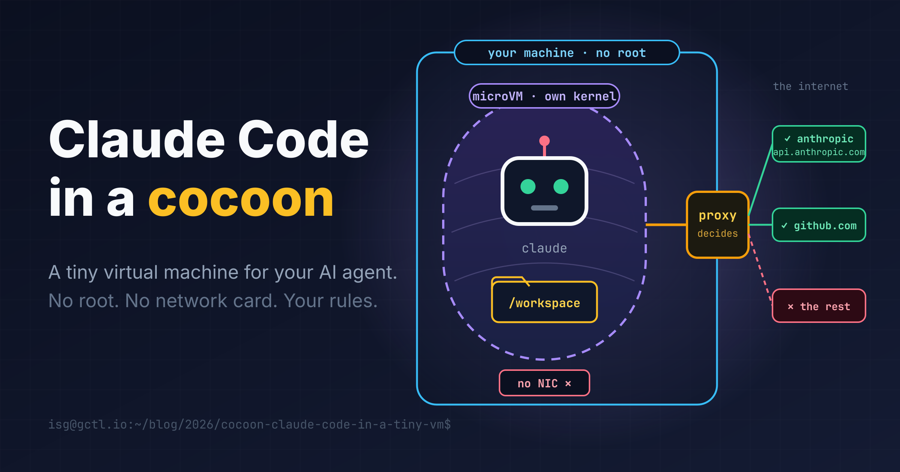

<figure class="post-figure">
  
</figure>

Claude Code is a coding agent. You ask it to fix a bug, and it reads your files, runs shell commands, installs packages and edits your code. That is the whole point of it. It is also exactly what would make you nervous if a stranger did it on your laptop. 😬

So I built **cocoon**. It runs Claude Code inside a small virtual machine on your own Linux computer. The agent gets a real Linux, real tools and your project folder. It does not get your home directory, your other files, or an open line to the internet.

Here is how it works, with pictures. If you use Linux, you can follow along: I explain each new word as it comes up. Claude Code is made by Anthropic; cocoon is my own project and is not an Anthropic product.

## 📝 TL;DR

- 🦋 **cocoon** starts a tiny virtual machine, runs Claude Code inside it, and wires your terminal to it. You type `cocoon` in a project folder, and you are talking to Claude Code as usual.
- 🔒 **No root.** No `sudo`, nothing installed system-wide. It is one file you download.
- 🚫🌐 **No network card in the VM.** The only way out is one door, a small program on your machine that checks every connection against a list you control, and writes down every attempt.
- 📁 **Your folder, your choice.** The agent can work on your real folder (the default), or on a throwaway copy that you review before anything is applied.
- ⚠️ **It is a strong wall, not a perfect one.** The last section says what it does not stop.

<div class="terms" markdown="1">

**📖 Words you will meet**

- **Virtual machine (VM).** A pretend computer that runs as a program on your real one. It has its own kernel, its own disk and its own memory, so what happens inside stays inside.
- **microVM.** A VM stripped to the bare minimum: no screen, no BIOS, no USB, just a handful of virtual devices. Less to build means less to break, and it starts fast.
- **Kernel.** The core of an operating system, the part that talks to hardware and decides what each program may do. Linux is a kernel. A VM runs its own, separate from yours.
- **KVM.** The part of Linux that lets a program use your CPU's built-in virtualization. You reach it through the file `/dev/kvm`.
- **Hypervisor (or VMM).** The program that creates and runs VMs. cocoon uses [Cloud Hypervisor](https://www.cloudhypervisor.org/).
- **Rootless.** Everything runs as your normal user. Nothing needs administrator rights.
- **Proxy.** A go-between. A program asks the proxy to open a connection for it, and the proxy decides yes or no.
- **vsock.** A private pipe between a VM and the machine hosting it. It works with no network card at all.
- **virtio-fs.** A way to share a folder between the host and a VM, so both sides see the same files.

</div>

## 🤔 Why a whole virtual machine?

Claude Code asks permission before it does risky things, and that helps. But a permission prompt is a person getting tired late at night and pressing Enter. I wanted a wall that does not depend on anyone being careful.

You can build walls on Linux in several ways, with containers, seccomp filters, namespaces and so on. I wrote about those in [Sandboxing untrusted AI agents on Linux](). They all have one thing in common: the code inside still talks to **your** kernel. If the kernel has a bug, the wall has a hole.

A virtual machine is different. The agent runs on a **second kernel**, and your real kernel only sees a small, boring set of virtual devices. To get out, you would have to break the VM software, not just trick a program on your system.

The usual objection is "VMs are heavy and slow". A microVM is not. In my runs, the first program inside the VM started 0.07 seconds after the kernel began booting, and once everything is set up, a VM boots and runs `claude --version` in about a quarter of a second.

## 🧭 The big picture

Here is everything in one picture. Read it from the left.

<figure class="post-figure">
  
  <figcaption>Everything in the blue box runs as you. The purple box is the only place the agent lives.</figcaption>
</figure>

When you type `cocoon`, this is what happens:

1. 🦋 **cocoon**, a single program written in Rust, reads your settings and gets everything ready. It builds the VM's small disks (without root), and starts the helpers.
2. 🚀 **Cloud Hypervisor** starts the VM and boots a Linux kernel straight into a tiny first program called `cc-init`. There is no long boot process; the kernel already has the drivers it needs built in.
3. 🏁 **cc-init** is the first program in the VM (the one that Linux calls "PID 1"). It sets up the disks, starts a little forwarder for network traffic, and then runs Claude Code on your terminal.
4. 💬 **You use Claude Code** exactly as you normally would. Your keystrokes go in, its screen comes out, and resizing your terminal resizes the VM's too.
5. 🧹 **You quit** with `/exit`. The VM powers off, cocoon prints what the agent tried to connect to, and everything temporary is deleted.

Inside the VM, the system is a small [Alpine Linux](https://alpinelinux.org/) with the tools a developer expects: bash, git, gh, ssh, ripgrep, jq, vim, Python, Node.js, a C compiler, Rust, Java and even headless Chromium. Its root disk is **read-only**, so a session cannot change the system underneath itself. Anything the agent installs lives on a scratch disk that is thrown away at the end.

## 🚪 The one door out

This is my favourite part. The VM has **no network card**. There is nothing to configure, firewall or forget about, because the hardware does not exist. A program that tries to open a normal connection simply finds no route.

Claude Code still has to reach its API, though, and it should be able to fetch from GitHub or npm. So there is exactly one door, and it works like this:

<figure class="post-figure">
  
  <figcaption>Every connection goes through the proxy. The proxy decides by host name, and writes it down.</figcaption>
</figure>

In words:

- Claude Code is told to use a proxy (through the standard `HTTPS_PROXY` setting), so it asks the **forwarder** inside the VM to open connections for it.
- The forwarder passes the bytes through **vsock**, the private pipe, to the **proxy** that cocoon runs on your machine.
- The proxy reads one line, like `CONNECT api.github.com:443`, and checks it against the list in your config file. If the host is on the list, it opens the connection and passes the data along. If not, it answers `403`, which means "refused".
- Either way, it **logs** the attempt. When your session ends, cocoon prints the log, with refused connections in red.

The default list covers what Claude Code needs to work: Anthropic's servers, GitHub, npm, PyPI and crates.io. To allow another site, you add one line to the config file. If you want the open internet, `allow_all = true` allows any public address, but even then your router, your local network and your cloud's metadata address (`169.254.169.254`, a place where cloud machines keep secrets) stay blocked.

One honest detail: the proxy sees **which host** the agent talked to and how many bytes moved, but not what was inside. The data is encrypted from Claude Code to the server, and cocoon does not break that open.

### 🔭 Seeing what Claude Code connects to

While building cocoon, I ran Claude Code with a deliberately wrong API key, just to see what it connects to on its own. The key was refused, so nothing was done or billed. The proxy log showed the calls to Anthropic that I expected, and one more: a connection to Datadog, a monitoring service. That is ordinary telemetry, the kind of thing most software sends so its makers can see how it is doing. It has nothing to do with your account, and it costs you nothing. Datadog was not on the allowlist, so cocoon declined it, and Claude Code carried on as normal.

There was nothing to fix. It is simply a nice example of what the log is for: it shows you everything your tools reach for, so you can decide what to allow. 👀

## 📁 Your project folder: live or copy

The agent needs your code, so cocoon has to get a project folder into the VM. There are two ways, and you pick one with a single line in the config file.

<figure class="post-figure">
  
  <figcaption>Live is convenient. Copy is careful.</figcaption>
</figure>

**Live mode** (the default) shares your real folder with the VM. You and the agent see each other's edits instantly, so you can keep your editor open while it works. The catch is in the picture: **nothing protects the folder**. If the agent deletes it, it is gone. Use live mode on a folder that is under version control. It is also slower for folders with huge numbers of small files such as `node_modules`; it can be three to ten times slower than on a normal disk.

**Copy mode** is the careful one. The agent works on a throwaway copy. When you quit, cocoon compares three versions of every file (how your folder looked when you started, how it looks now, and what the agent left) and shows you just the agent's changes:

```text
  workspace changes: 1 added, 1 changed, 1 deleted
    + added.txt
    ~ edit.txt
    - gone.txt
  apply these to /home/alice/code/api? [y/N]
```

Press `y` and they are applied. Press `N`, and your folder was never touched. Files you edited yourself in the meantime are never overwritten, and if you and the agent both changed the same file, it is flagged as a conflict and left alone.

## 🏃 Try it

**What you need:**

| | |
| --- | --- |
| 🐧 **Linux on x86_64** | arm64 is not released yet |
| ⚙️ **KVM** | read and write access to `/dev/kvm`, usually by being in the `kvm` group |
| 🧱 **e2fsprogs** | the `mkfs.ext4` and `debugfs` tools, which nearly every distribution already has |
| 💾 **About 4 GB of disk** | for the first run |
| 🧠 **About 4 GB of memory** | per session, and you can change it |
| 🔑 **A Claude login** | a subscription (Pro, Max, Team or Enterprise) or an Anthropic API key |

You do **not** need root, Docker or anything else. The binary is large, about 540 megabytes, because the whole VM (kernel, system disk and helpers) is inside it.

**Install.** The prebuilt binary and the user guide live in the [cocoon-releases](https://github.com/ishworgurung/cocoon-releases) repository on GitHub. The source code is not published there. One line does it:

```sh
curl -fsSL https://raw.githubusercontent.com/ishworgurung/cocoon-releases/main/install.sh | bash
```

It downloads the binary, checks its SHA-256 against the published checksum, and puts it in a bin folder under your home directory. It never edits your shell profile, and uses no `sudo`. If you would rather read the script first, or do it all by hand and check the checksum yourself, the [repository's README](https://github.com/ishworgurung/cocoon-releases#-install) shows how.

**Check your machine.** This command looks at everything cocoon needs, and for each problem it prints the fix:

```sh
cocoon --doctor
```

**Log in once.** Pick the way you pay for Claude:

```sh
cocoon --oauth-token     # Claude subscription: paste the token that `claude setup-token` printed
cocoon --api-key         # Anthropic API key, pay per use
```

Or just start `cocoon` and type `/login` inside. One trap here: a paid claude.ai plan is **not** API credit. If you use an API key, it bills the separate API account, never your subscription. If the header in Claude Code says "API Usage Billing" and you did not mean it, delete the saved key and log in with the subscription instead.

**Run it:**

```sh
cd ~/code/my-project
cocoon
```

The first run takes about ten seconds. cocoon unpacks the VM and downloads Claude Code from npm, checking it against a fingerprint (a SHA-512 hash) that the binary was built with. Claude Code is proprietary, so cocoon does not bundle it; it fetches it, and refuses to use a copy that does not match. After that, a VM boots in well under a second. You will see a short summary of what is about to start, a five-second boot menu in the style of a boot loader (press Enter to boot at once), and then Claude Code, working in your folder.

| I want to... | Run |
| --- | --- |
| 🤖 Claude Code on this folder | `cocoon` |
| ↩️ continue the last conversation | `cocoon -c` |
| 💬 ask a one-off question | `cocoon -p "fix the failing tests"` |
| 🐚 a shell in the VM instead | `cocoon shell` |
| 🌐 see a dev server in my browser | `cocoon -P 3000`, then open `http://127.0.0.1:3000` |
| 🔌 a second terminal in the same VM | `cocoon --attach` |

Anything cocoon does not recognise goes straight to Claude Code, so `cocoon --model opus` works as you would expect. cocoon's own switches, like `-W` for another folder, go **first**; if you put one in the wrong place, it stops and shows you the fix rather than ignoring it.

## 🔬 For the curious: what is under the hood

If you like knowing how things work, a few details I enjoyed:

<div class="mermaid">
flowchart LR
    A["cocoon<br/>(you ran it)"] --> B["Cloud Hypervisor<br/>starts the VM"]
    B --> C["Linux kernel<br/>boots, no initramfs"]
    C --> D["cc-init<br/>PID 1"]
    D --> E["forwarder<br/>+ Claude Code"]
</div>

- 🪶 **No installer, no root, even for disks.** Normally you need root to build a disk image with files owned by root. cocoon makes them with `mkfs.ext4 -d`, which copies a folder into a new ext4 disk as an ordinary user, and then fixes up each file's owner and permissions with `debugfs`. Even the shared folder runs as you: its helper, virtiofsd, lives in its own user namespace where the VM's "root" is just your user.
- 🐧 **No initramfs.** Most Linux machines boot into a small temporary system first, which loads drivers before the real disk can be mounted. This kernel is built with the drivers it needs already inside, so it mounts the disk and starts `cc-init` directly. That is part of why it is fast.
- 🦀 **Tiny static programs.** `cc-init` and the forwarder are small Rust programs with no dependencies on the system image. The whole thing, host side included, is Rust.
- ✅ **Every download is checked.** The kernel, Cloud Hypervisor, virtiofsd, Alpine and Claude Code are each checked against a pinned checksum or a signed package list before use.

## ⚠️ What it does not do

A sandbox that oversells itself is worse than none, so here is the honest list.

- 📁 **Live mode can delete your folder.** That is the cost of convenience. Use git, or switch to copy mode.
- 🧱 **A VM is strong, not perfect.** The wall is built from hardware virtualization plus software (KVM and Cloud Hypervisor), and software has bugs. Cloud Hypervisor is written in Rust and keeps a small set of virtual devices, which helps, but I do not claim it is escape-proof. I have not yet locked Cloud Hypervisor down further with its own Landlock option; that is on my to-do list. And no VM stops side channels, where programs on the same CPU learn things from timing, which I wrote about in [When sandboxed agents talk through the CPU cache]().
- 🌐 **An allowed host is an allowed host.** The proxy can only judge by name. If GitHub is on your list, the agent can talk to GitHub, and a tricked agent could in principle send your code somewhere through it. Keep the list as short as you can live with, and read the log.
- 🔑 **The login lives with the agent.** Claude Code needs your login to work, so during a session it is inside the VM. cocoon passes it on a throwaway disk that is deleted afterwards, and keeps no secrets on the command line or in the system image. Saved logins sit on your disk readable only by you, but they are **not** encrypted, just protected by file permissions like your SSH keys.
- 🧪 **It is early.** This is version 0.0.1. It is built for x86_64 Linux only. An arm64 build exists, but no arm64 VM has been booted yet, and it is not released. The source is not published.

## 🎁 Wrapping up

The idea behind cocoon is small: give the agent a real computer of its own, with **one** door, and put you at the door. You can still be productive, and when something odd happens, it happens in a room you can throw away. 🦋

If you try it, run `cocoon --doctor` first. The [troubleshooting guide](https://github.com/ishworgurung/cocoon-releases/blob/main/docs/TROUBLESHOOTING.md) in the repository covers the errors you are most likely to meet, and the [usage guide](https://github.com/ishworgurung/cocoon-releases/blob/main/docs/USAGE.md) has the config file and every switch.

> Point-in-time (19 November 2026): cocoon v0.0.1. Details such as the default allowlist and the size of the download will change between releases; check the repository for the current state.
