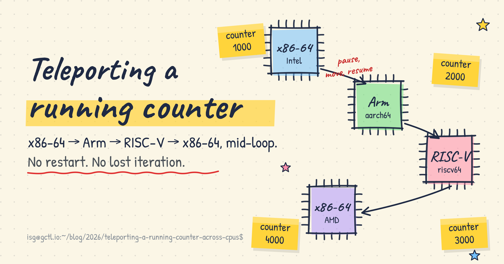

<style>
  /* Wrap long lines in this post's code blocks instead of scrolling sideways. */
  .post-content pre, .post-content pre code, article pre, article pre code {
    white-space: pre-wrap;
    overflow-wrap: anywhere;
    overflow-x: visible;
  }
</style>

<figure class="post-figure">
  
</figure>

What if a running program could pick up and move, without restarting? Imagine it counting, part way through its loop. You pause it on an Intel machine and set it down on an Arm machine, and it carries on from the very same number. Then you hand it to a RISC-V machine, and it carries on again. No restart, no lost work, and no care for which chip is underneath. If that worked, a program would no longer belong to the machine it started on.

Intel, Arm and RISC-V chips speak three different machine languages. A program is written in one of them. So how can one running program hop between them?

I wanted to find out, so I built a small lab: one counter, four virtual machines, and a tool that pauses the counter and restores it somewhere else. I also ran the usual tool for moving processes, CRIU, on the same moves, to see exactly where it fails. This post is the notebook of what I asked, what I tried, and what broke along the way.

## 📝 The short answer

- ✅ **Yes, it works.** A counter went 1000, 2000, 3000, 4000 across x86-64 (Intel model), Arm, RISC-V and x86-64 again (AMD model). Then a whole Python interpreter, paused in the middle of a script, did the same.
- 🧳 **The trick is what travels.** The program's *code* never moves. Every machine compiles the same WebAssembly file for its own chip. Only the program's *state* moves, as plain bytes in a directory the lab calls a capsule, a purpose-built format created for this experiment.
- 🧨 **The control experiment fails in an instructive way.** CRIU refuses to move a native process to another kind of CPU. It also "succeeded" on a move between two x86 CPUs, and then the process died on its first string function.
- 🌐 **A network connection does not move.** A program that talks to a server keeps its memory but loses the connection, and it carries on only if the server kept its state under a token. CRIU can keep a connection, but only when the network path carries it: it worked with the server inside the same VM and with a floating IP moved across hosts, and it failed through QEMU's user-mode network.
- 🔭 **The hard part is still open.** Pausing at any moment, moving less data, and moving open files and threads, and keeping live connections to real services such as a database, are all unsolved here.

<div class="terms" markdown="1">

**📖 Words you will meet**

Every term in the post is listed here once, with a link to a source. Skim it now, or come back when a word stops you.

*Chips and machines*

- **[CPU](https://en.wikipedia.org/wiki/Central_processing_unit) and [ISA](https://en.wikipedia.org/wiki/Instruction_set_architecture).** The CPU (central processing unit) is the chip that runs programs. Its ISA (instruction set architecture) is the machine language it understands.
- **[x86-64](https://en.wikipedia.org/wiki/X86-64), [AArch64](https://developer.arm.com/documentation/ddi0487/latest) and [RISC-V](https://riscv.org/).** Three ISAs. x86-64 is what Intel and AMD make. AArch64 is 64-bit Arm. RISC-V is an open one. I call them x86-64, Arm and RISC-V.
- **CPU models.** QEMU can present a VM as a named chip: [Icelake](https://en.wikipedia.org/wiki/Ice_Lake_(microarchitecture)) (Intel server), [Neoverse N1](https://www.arm.com/products/silicon-ip-cpu/neoverse/neoverse-n1) (Arm server, used in [AWS Graviton](https://aws.amazon.com/ec2/graviton/)), [EPYC-Genoa](https://en.wikipedia.org/wiki/Epyc) (AMD server), [Opteron](https://en.wikipedia.org/wiki/Opteron) (older AMD) and [Denverton](https://en.wikipedia.org/wiki/Denverton) (Intel Atom, no AVX). `rv64` is QEMU's plain 64-bit RISC-V.
- **[VM](https://en.wikipedia.org/wiki/Virtual_machine), [QEMU](https://www.qemu.org/), [KVM](https://linux-kvm.org/) and [TCG](https://www.qemu.org/docs/master/devel/tcg.html).** A VM (virtual machine) is a pretend computer that runs as a program. QEMU is the program I use to make them. KVM (Kernel-based Virtual Machine) lets a VM run on the real CPU at full speed. TCG (Tiny Code Generator) is QEMU's software mode, which emulates a CPU, even one the real chip is not.
- **[Debian](https://www.debian.org/).** The Linux distribution the four VMs run.

*What a program is made of*

- **[Process](https://en.wikipedia.org/wiki/Process_(computing)) and [PID](https://en.wikipedia.org/wiki/Process_identifier).** A process is a running program. The PID (process ID) is its number.
- **[Registers](https://en.wikipedia.org/wiki/Processor_register), [call stack](https://en.wikipedia.org/wiki/Call_stack) and [heap](https://en.wikipedia.org/wiki/Memory_management#HEAP).** Registers are the CPU's few dozen tiny storage slots. The call stack holds the functions that are running right now, with their local variables. The heap holds data that outlives a call.
- **[Little-endian](https://en.wikipedia.org/wiki/Endianness).** Storing the small end of a number first. The same bytes mean the same number only if everyone agrees on this.

*WebAssembly*

- **[WebAssembly](https://webassembly.org/) (Wasm).** A portable program format. A `.wasm` file holds instructions for no real CPU. A *module* is one such file. The [spec](https://webassembly.github.io/spec/core/) defines it.
- **Runtime, host and guest.** A runtime compiles and runs Wasm. The *host* is the program that runs it. The *guest* is the Wasm program inside. My host is built on [wasmtime](https://wasmtime.dev/) ([Rust API](https://docs.rs/wasmtime/)), whose compiler is [Cranelift](https://cranelift.dev/).
- **[AOT](https://en.wikipedia.org/wiki/Ahead-of-time_compilation) and [JIT](https://en.wikipedia.org/wiki/Just-in-time_compilation).** Compiling a module ahead of time, or just in time, when it is loaded.
- **[WASI](https://wasi.dev/).** The WebAssembly System Interface: how a Wasm program asks for arguments, files and the clock. I used its first version, "preview 1".
- **Linear memory, globals and imports.** Linear memory is all the memory a Wasm program can touch, one flat array of bytes. Globals are a few typed values outside it, such as the stack pointer. An import is a function the module calls but the host supplies. (All three are defined in the [spec](https://webassembly.github.io/spec/core/).)
- **[Asyncify](https://kripken.github.io/blog/wasm/2019/07/16/asyncify.html).** A rewriting pass in [Binaryen](https://github.com/WebAssembly/binaryen)'s `wasm-opt` tool. It lets a Wasm program save its call stack into memory and later rebuild it.
- **[Rust](https://www.rust-lang.org/), [wasi-sdk](https://github.com/WebAssembly/wasi-sdk), [CPython](https://github.com/python/cpython/tree/main/Tools/wasm) and [zig](https://ziglang.org/).** Rust and wasi-sdk (a C toolchain for Wasm) build my guests. CPython is the standard Python. zig is the cross C compiler I use for my host.

*Moving a native process*

- **[CRIU](https://criu.org/).** Checkpoint/Restore In Userspace: a Linux tool that saves a running process to files and recreates it from them. It is how containers are usually moved.
- **[glibc](https://www.gnu.org/software/libc/) and [musl](https://musl.libc.org/).** Two C libraries for Linux. glibc is the usual one. musl is a smaller one.
- **[IFUNC](https://sourceware.org/glibc/wiki/GNU_IFUNC).** A glibc trick: a function whose real code is chosen once, at start-up, by asking the CPU what it can do.
- **[`GLIBC_TUNABLES`](https://www.gnu.org/software/libc/manual/html_node/Tunables.html).** An environment variable that changes such choices.
- **[CPUID](https://en.wikipedia.org/wiki/CPUID) and [XCR0](https://cdrdv2.intel.com/v1/dl/getContent/671200).** CPUID is the instruction a program uses to ask the CPU what it supports. XCR0 (extended control register 0) is the bit mask of register groups the operating system has switched on. (XCR0 is in Intel's manual.)
- **[SSE2](https://en.wikipedia.org/wiki/SSE2), [AVX and AVX2](https://en.wikipedia.org/wiki/Advanced_Vector_Extensions).** Vector instruction sets on x86-64. SSE2 is the baseline. AVX and AVX2 are newer, 256-bit, and use the YMM registers. AVX-512 is the 512-bit one, and EVEX is its encoding. PKRU is a register for memory-protection keys.
- **[SIGILL](https://man7.org/linux/man-pages/man7/signal.7.html).** The signal Linux sends a process that runs an illegal instruction.

*Talking to a server*

- **[Socket](https://man7.org/linux/man-pages/man7/socket.7.html) and [TCP](https://www.rfc-editor.org/rfc/rfc9293).** A socket is a program's handle on a network connection. TCP (Transmission Control Protocol) is the reliable byte stream most services use. A connection exists as state in two kernels, one at each end.
- **[HTTP](https://www.rfc-editor.org/rfc/rfc9110), HTTPS and [TLS](https://www.rfc-editor.org/rfc/rfc8446).** HTTP is the web's request and reply protocol. HTTPS is HTTP carried inside TLS (Transport Layer Security), the encryption layer.
- **[VIP](https://en.wikipedia.org/wiki/Virtual_IP_address), [Ethernet](https://en.wikipedia.org/wiki/Ethernet), [MAC](https://en.wikipedia.org/wiki/MAC_address), [ARP](https://www.rfc-editor.org/rfc/rfc826) and [gratuitous ARP](https://www.rfc-editor.org/rfc/rfc5227).** A VIP (virtual IP address) is an address that belongs to a service rather than to one machine's network card, and a floating IP is a VIP that can be reassigned from one host to another. On an Ethernet segment a frame goes to a MAC (the hardware address of one network card). ARP (Address Resolution Protocol) finds the MAC that owns an IP, and a gratuitous ARP is an unrequested message saying "this IP is at my MAC".
- **[errno](https://man7.org/linux/man-pages/man3/errno.3.html).** The number Linux uses for a failed system call. Error 9 is "bad file descriptor".
- **Session, token and [transaction](https://en.wikipedia.org/wiki/Database_transaction).** A session is state a server keeps for you. A token is the short string that names it. A transaction is a group of steps the server applies all together or not at all, and it can be rolled back. An [RPC](https://en.wikipedia.org/wiki/Remote_procedure_call) (remote procedure call) is a request to run a function in another process.

*Other terms*

- **[SHA-256](https://csrc.nist.gov/pubs/fips/180-4/upd1/final).** A hash: a fingerprint of some bytes.
- **[NaN](https://en.wikipedia.org/wiki/IEEE_754).** "Not a number", a floating-point value whose exact bits differ between chips.

</div>

## 🤔 Why would anyone want to do this?

I came to this question from a product called [Portal](https://portal.clusy.io/), by Clusy, which moves a running Python job between machines of any cloud and any CPU type, and between CPUs and GPUs.

Here are some reasons:

1. **Capacity and price.** Cloud machines come in x86 and Arm. A job that has run for hours may need to move when one kind becomes scarce or costs more.
2. **Machines that disappear.** Some cheap cloud machines can be taken away at short notice. A job that can move is a job that does not start from zero.
3. **Freezing a bug.** If you can freeze a running program and move it, you can hand a live failure to someone else.
4. **Maintenance without downtime.** To patch or retire a machine, you drain it. A job that can move is a job you do not have to wait for, even when the replacement machine has a different CPU.
5. **Moving a fleet between CPU families.** A team that wants to shift from x86 to Arm servers can move the work gradually, job by job, instead of stopping everything and restarting it.
6. **Long jobs on mixed hardware.** A long simulation or batch run on a cluster with different kinds of machines can resume on whatever is free after a failure, instead of waiting for the same kind of machine to come back.
7. **Work that follows the data or the user.** A job can move closer to the data it reads, or out to an edge device, even when the device has a different CPU from the server it started on.
8. **Making room.** A scheduler can pause a low-priority job to free a machine for an urgent one, and resume the paused job later on any machine.
9. **Starting warm.** A program that spends seconds starting up could be paused once, right after start-up, and every copy could resume from that point on any CPU. Cloudflare's Python Workers already do a version of this, for start-up only (see the table of other projects near the end).
10. **Testing across CPUs.** The same paused state can be resumed on x86, Arm and RISC-V to see whether the program behaves the same on each.

Most of these need the same thing: the program must keep running on a different kind of CPU. So I started with six questions.

1. Can a running program move to a CPU of a different kind?
2. What exactly would have to move?
3. Why does the usual tool, CRIU, say no?
4. What does it take to make the answer yes?
5. What goes wrong on the way?
6. What is still unsolved?

The rest of the post answers them in that order.

## 🧠 Why can't a normal program just move?

A normal program is a pile of machine code for one ISA. When it runs, its state includes that machine code, the CPU's registers (a few dozen tiny fast storage slots), the stack of function calls, and the heap. Save all that and you have a snapshot of one specific chip's work.

<figure class="post-figure">
  
  <figcaption>Left: everything a native process saves is tied to its CPU. Right: a Wasm program is compiled fresh on each CPU, so only its state has to travel.</figcaption>
</figure>

This is where CRIU fails on a move from Intel to Arm. I tried it. CRIU on the Arm machine looked at the saved image and stopped:

```text
Error (criu/cr-restore.c:854): Core march mismatch 1
```

"March" here means machine architecture. The image holds x86-64 registers and x86-64 code, and an Arm CPU cannot run either.

A WebAssembly program is different, and that difference is the whole idea. The `.wasm` file holds no machine code. Each machine compiles it for itself. What is left to move is the program's *state*, and a Wasm instance keeps its state in only a few places, and all of them mean the same thing on every machine:

- **Linear memory.** One flat array of bytes. The Wasm spec fixes its byte order as little-endian on every machine, so the same bytes mean the same numbers on x86-64, Arm and RISC-V.
- **Globals.** A few typed values, such as the stack pointer.
- **WASI state.** The program's arguments, open folders and clock, which live in the host program that runs the module.

That is the answer to question 2: **memory, globals and a little host state**. The lab saves them into a directory it calls a capsule, a purpose-built format we created for this experiment. The name is borrowed, and the word is older than WebAssembly: it comes from ["Optimizing the Migration of Virtual Computers"](https://www.usenix.org/legacy/event/osdi02/tech/full_papers/sapuntzakis/sapuntzakis_html/index.html) (Sapuntzakis, Chandra, Pfaff, Chow, Lam and Rosenblum, OSDI 2002), which introduced "capsule" for a machine's state as a data type, apart from the machinery that executes it. That paper moved whole x86 machines. Here the capsule is a Wasm instance's state, in four files.

## 🧪 The setup: four machines on one desktop

The lab is four [QEMU](https://www.qemu.org/) virtual machines, each booting a [Debian](https://www.debian.org/) 13 image for its own ISA. I fetched the images and checked each one against Debian's `SHA512SUMS` file.

<figure class="post-figure">
  
  <figcaption>Four hosts, in hop order. h4 is also rebooted as other CPU models for the CRIU control experiment.</figcaption>
</figure>

The table says what each host stands for, and how it runs:

| Host | ISA | CPU model | How it runs | Stands for |
| --- | --- | --- | --- | --- |
| h1 | x86-64 | Icelake-Server | KVM | an Intel cloud VM |
| h2 | AArch64 | Neoverse N1 | TCG | an Arm server such as Graviton |
| h3 | RISC-V | rv64 | TCG | a RISC-V board |
| h4 | x86-64 | EPYC-Genoa (later Opteron, Denverton for CRIU) | KVM | an AMD cloud VM |

Caveats that change what the results mean:

- **h2 and h3 are emulated.** They run in QEMU's software mode, so they are Arm and RISC-V cores in software, not real chips. The Wasm side does not depend on the CPU, but I have not seen a real Graviton or a real RISC-V board.
- **h1 and h4 run on KVM,** so their instructions run on my real Intel i9. QEMU's CPU *model* only changes what the CPU *reports*. So h4 is an AMD EPYC-Genoa *model* on Intel silicon, not a real AMD chip. That matters in the CRIU section.
- **h1 is not a complete Icelake.** KVM can only offer features the real CPU has, and my i9 has no AVX-512 or Intel's two transactional-memory features (HLE and RTM). QEMU warns and drops them.
- **All four are hops.** The order is h1, h2, h3, h4, so the program ends back on x86-64, on a CPU model from a different vendor than where it started.
- **The "network" is a copy.** Between hosts, the capsule is copied from one VM's shared folder to the next one's. There is no real network.
- **A fifth VM, h5, joins only the last experiment.** It runs a test server on a private link between h1, h4 and h5. It is not a hop, and `make up` does not start it.

Everything below ran on this one machine, in November 2026. The commands are `make` targets: `make tools images up` boots the VMs (74 seconds in my run), `make host` builds my runtime for the three ISAs (h4 reuses the x86-64 build), and `make demo-step`, `make demo-async` and `make python demo-py` run the three demos.

## 🧳 The capsule: a suitcase of state

My host program is called `tc` (for teleport counter). It is a Rust program built on the `wasmtime` crate, and I built it once for each ISA. It saves a paused program into a capsule.

<figure class="post-figure">
  
  <figcaption>A capsule is four files. None of them names the CPU that wrote it.</figcaption>
</figure>

The `manifest.json` file ties the others together. Here is a real one, from the format notes in the repository, trimmed:

```json
{
  "version": 0,
  "mode": "async",
  "entry": "_start",
  "module_sha256": "cfa2985435f4dffd4ea6...",
  "wasmtime_version": "50.0.1",
  "source_host": "h2",
  "source_arch": "aarch64",
  "cpu_model": "Arm Neoverse-N1 (implementer 0x41, part 0xd0c)",
  "counter_hint": 2000,
  "memory_sha256": "f7ea57278033092f8900...",
  "memory_pages": 18,
  "globals_sha256": "85e15c799d4fa3bf3665...",
  "wasi_sha256": "686dd98dbebba28d2e07...",
  "asyncify_buffer": 1061556,
  "hops": [ { "host": "h1", ... }, { "host": "h2", ... } ]
}
```

A SHA-256 hash is a fingerprint of some bytes. The manifest holds the fingerprint of the Wasm module and of the other three files, and the capsule's own name is the fingerprint of the manifest. So one short hash covers the whole capsule.

Restore is **fail closed**: if anything does not match, it refuses to run. There are ten checks, and each has a test that breaks exactly that one thing:

1. all four files are present;
2. the format `version` is 0, and the wasmtime version is the same;
3. the three file hashes match, and `memory.bin` is `memory_pages` × 64 KiB;
4. an async capsule records an Asyncify buffer address;
5. the arguments and the opened folders match;
6. the module hash matches the module being started;
7. the module's Asyncify buffer is at the recorded address;
8. the capsule's memory is at least as big as the module's own;
9. the globals are exactly the module's mutable globals, with the same types;
10. on resume, the rewind reaches `ckpt.checkpoint()`.

The manifest also keeps a `hops` list, one entry per pause, which is how a demo shows that each host resumed the capsule the previous one wrote.

## 🔧 How it works: three rounds, each harder

This is the meat. I built it in three rounds, each pausing the program in a harder place.

### Round 1: pause between two calls

The simplest place to pause is *between* two function calls, because no function is running then, so there is no call stack to save. The first guest is a Rust program that counts in a static variable. This is all of it:

```rust
static COUNTER: AtomicU64 = AtomicU64::new(0);

#[unsafe(no_mangle)]
pub extern "C" fn step() -> u64 {
    COUNTER.fetch_add(1, Ordering::Relaxed) + 1
}
```

(I left out `init()`, which sets the counter to zero.) The static lives at a fixed address in linear memory. The host calls `step()` 1000 times, saves the capsule, and the next host restores it and calls `step()` 1000 more times:

```text
[1/4] h1: x86_64, CPU model Icelake-Server, runs on the real CPU (KVM)
  got   saved capsule f9bbc08c: program memory 1088KiB, progress counter 1000
  next  copy the capsule from h1 to h2 (1.1M)

[2/4] h2: aarch64, CPU model neoverse-n1, emulated in software (QEMU TCG)
  got   capsule f9bbc08c loaded and verified (written on h1, x86_64); progress counter 1000 at that point
  got   paused again, saved capsule 41880577, progress counter 2000

[3/4] h3: riscv64, CPU model rv64, emulated in software (QEMU TCG)
  got   capsule 41880577 loaded and verified (written on h2, aarch64); progress counter 2000 at that point
  got   paused again, saved capsule efde0673, progress counter 3000

[4/4] h4: x86_64, CPU model EPYC-Genoa, runs on the real CPU (KVM)
  got   capsule efde0673 loaded and verified (written on h3, riscv64); progress counter 3000 at that point
  got   ran to the end, progress counter 4000
```

I trimmed the lines, but not the numbers. **Each host names the capsule the previous host wrote**, and the module hash stays the same on all four. The whole `make demo-step` target took 5 seconds in the recorded run.

How do I know the counter really crossed as bytes? I did not trust `tc`. A separate Python script reads the address of the counter from the module's own code, using `wasm-dis` (Binaryen's disassembler) to find an instruction `i64.load offset=1048584`, then reads 8 bytes at that address out of `memory.bin`:

```text
  got   the step counter lives at linear-memory address 1048584 (found by disassembling the module with wasm-dis)
  ok    .../wasm-step/cap-0: written on h1 (x86_64); all three hashes match; the counter read from memory.bin is 1000
  ok    .../wasm-step/cap-1: written on h2 (aarch64); all three hashes match; the counter read from memory.bin is 2000
  ok    .../wasm-step/cap-2: written on h3 (riscv64); all three hashes match; the counter read from memory.bin is 3000
```

**The counter is 8 bytes.** The capsule that carries it is 1088 KiB, because linear memory includes a 1 MiB call stack that the Rust compiler keeps in memory, and almost all of it is zeros.

### Round 2: pause in the middle of a call

Round 1 cheats a little. It pauses *between* calls. A real program is usually deep inside several calls when you want to pause it, and then the live call stack matters. On a normal CPU, that stack sits in the CPU's own registers and layout. How can it move?

The answer is **[Asyncify](https://kripken.github.io/blog/wasm/2019/07/16/asyncify.html)**, a rewriting pass in [Binaryen](https://github.com/WebAssembly/binaryen)'s `wasm-opt`, described in Alon Zakai's 2019 post. It changes every function that can reach a chosen import, so each of them can do two new things: **unwind** (save its local variables and its position into a buffer in linear memory, then return early) and **rewind** (later, reload them and jump back to where it was). I ran it like this:

```sh
wasm-opt --asyncify --pass-arg=asyncify-imports@ckpt.checkpoint ...
```

<figure class="post-figure">
  
  <figcaption>Unwinding folds the whole call stack into a buffer in memory. Rewinding unfolds it on another machine.</figcaption>
</figure>

Here are the steps, in order:

1. The guest calls an import named `ckpt.checkpoint()`. The host program answers by telling Asyncify: start unwinding.
2. Every function on the stack saves its locals into the buffer and returns.
3. The stack is now empty, and the buffer in linear memory holds all of it. The host copies memory and globals into a capsule.
4. On the next machine, the host restores memory and globals, tells Asyncify to start rewinding, and calls the entry point again.
5. Every function reloads its locals and jumps back to the call it was in, until the program reaches `ckpt.checkpoint()` again. The host says: stop rewinding, and returns. The program carries on as if nothing had happened.

The guest for this round counts to 4000 in a *local variable* on the stack. It also keeps a heap vector called `history`. It calls the checkpoint every 1000 iterations:

```rust
fn main() {
    let start = Instant::now();
    let mut history: Vec<u64> = Vec::new();
    let mut sum: u64 = 0;
    for i in 1..=TOTAL {
        sum = sum.wrapping_add(i * i);
        // ... prints progress every 250 iterations ...
        if i % EVERY == 0 && i < TOTAL {
            history.push(i);
            unsafe { HINT = i as i64; checkpoint(); }
        }
    }
}
```

(I trimmed the printing.) Nothing is set up again on resume. If the loop variable, the vector or the start time came back wrong, the output would show it.

The host side is one function, the import that the guest calls. A wasmtime `Linker` (the table of imports the host offers) registers it under the name `ckpt.checkpoint`. It handles the two cases, rewinding and the first, normal call. This is the real code from `runtime.rs` (wasmtime 50.0.1), unchanged:

```rust
fn checkpoint(mut caller: Caller<'_, HostState>) -> Result<()> {
    let state_fn = caller
        .get_export("asyncify_get_state")
        .and_then(Extern::into_func)
        .ok_or_else(|| format_err!("ckpt.checkpoint() called but the module is not Asyncify'd"))?;
    let mut state = [Val::I32(0)];
    state_fn.call(&mut caller, &[], &mut state)?;
    match state[0].unwrap_i32() {
        ASYNCIFY_REWINDING => {
            let stop = caller.get_export("asyncify_stop_rewind").and_then(Extern::into_func).expect("Asyncify export");
            stop.call(&mut caller, &[], &mut [])?;
            caller.data_mut().rewound = true;
            Ok(())
        }
        ASYNCIFY_NORMAL if caller.data().unwind_at_next => {
            let buf = caller.data().asyncify_buffer.expect("checked before the call");
            let size = caller.data().asyncify_buffer_size;
            // Asyncify's data header: two i32s, the next free byte and the end.
            let memory = caller.get_export("memory").and_then(Extern::into_memory).expect("memory export");
            let header = [(buf + 8).to_le_bytes(), (buf + size).to_le_bytes()].concat();
            memory.write(&mut caller, buf as usize, &header)?;
            let start =
                caller.get_export("asyncify_start_unwind").and_then(Extern::into_func).expect("Asyncify export");
            start.call(&mut caller, &[Val::I32(buf as i32)], &mut [])?;
            let data = caller.data_mut();
            data.unwound = true;
            data.unwind_at_next = false;
            Ok(())
        }
        ASYNCIFY_NORMAL => Ok(()),
        s => bail!("ckpt.checkpoint() reached in Asyncify state {s}"),
    }
}
```

**The same function does both jobs.** If Asyncify says "rewinding", this call is the program arriving back at the point where it paused, so the host ends the rewind. Otherwise it starts the unwind. On restore, the host copies the saved bytes into a fresh instance's memory and sets each saved global. (I left out the `match` that turns each saved value into a `Val`, and the checks that come before it.)

```rust
memory.grow(&mut g.store, ((capsule.memory.len() - have) / WASM_PAGE) as u64)?;
memory.data_mut(&mut g.store).copy_from_slice(&capsule.memory);
for (name, value) in &capsule.globals {
    let global = g.instance.get_global(&mut g.store, name).expect("listed above");
    global.set(&mut g.store, val)?;
}
```

Now the result, trimmed to the lines that matter:

```text
[1/4] h1 (x86_64)
  prog  i=1000 sum_sq=333833500 history=[] t=1ms
[2/4] h2 (aarch64)
  prog  i=1250 sum_sq=651823125 history=[1000] t=56ms
[3/4] h3 (riscv64)
  prog  i=2250 sum_sq=3799406625 history=[1000, 2000] t=135ms
[4/4] h4 (x86_64)
  prog  i=3250 sum_sq=11447990125 history=[1000, 2000, 3000] t=161ms
  prog  done: i=4000 sum_sq=21341334000 (expected 21341334000) history=[1000, 2000, 3000]
```

What carried across, line by line:

- **The loop variable.** The first line on h2 is i=1250, so the loop continued exactly after 1000. It is a local variable in a function that was live at the pause.
- **The heap.** `history` grew from `[1000]` to `[1000, 2000, 3000]`, across three hops.
- **No lost or repeated iteration.** `sum_sq` ends at 21341334000, the closed-form value of 4000 × 4001 × 8001 ÷ 6.
- **The clock.** `t` never goes back. A Wasm program's monotonic clock normally restarts at zero on a new host, so `tc` saves the guest's clock in `wasi.json` and starts the next host's clock from that value.

**One global must not be forgotten.** The call stack that Rust keeps in linear memory is addressed by a global called `__stack_pointer`. Unwinding leaves it wherever the deepest frame put it, and rewinding skips the code that would set it again, so it has to travel in the capsule. By default the linker hides it, so the build exports it on purpose. I wrote a test that resets it to its initial value before resuming. The guest stops with a trap:

```text
wasm trap: indirect call type mismatch
```

The resumed program's new calls wrote over the rewound frames, and a function pointer among them was corrupted. Wasm checks the type of every indirect call, so the bad pointer became a clean trap, not a jump into the wrong code.

### Round 3: a whole Python interpreter, paused mid-script

Counting in Rust is one thing. What about a real interpreter? I built CPython 3.15.2 for WebAssembly with its own `Platforms/WASI` tooling, and added one small C module of my own, called `_ckpt`. This is the heart of it, with my explanatory comments trimmed:

```c
/* Import the function `checkpoint` from the host module `ckpt`. */
__attribute__((import_module("ckpt"), import_name("checkpoint")))
extern void ckpt_host_checkpoint(void);

#define CKPT_BUFFER_SIZE (1024 * 1024)
static unsigned char ckpt_buffer_data[CKPT_BUFFER_SIZE] __attribute__((aligned(16)));

/* Exported by name, so the host can find the buffer. */
__attribute__((export_name("ckpt_buffer")))
int ckpt_buffer(void) { return (int)(unsigned long)ckpt_buffer_data; }

/* The Python function _ckpt.checkpoint(). */
static PyObject *
ckpt_checkpoint(PyObject *module, PyObject *Py_UNUSED(ignored))
{
    ckpt_host_checkpoint();
    Py_RETURN_NONE;
}
```

After the Asyncify pass, that one import can unwind the whole C stack: `main`, the interpreter's evaluation loop, and this function. A script then calls it like any Python function:

```python
import _ckpt
total = 0
for i in range(40):
    total += i
    print(f"hello world {i} total={total}")
    if i in (9, 19, 29):
        _ckpt.checkpoint()
```

I ran this across all four hosts:

```text
[1/4] h1 (x86_64)
  prog  python 3.15.2 on wasi/wasm32
  prog  hello world 0 total=0
  prog  hello world 9 total=45
  got   saved capsule 160f8b2e: program memory 40960KiB
[2/4] h2 (aarch64)
  prog  hello world 10 total=55
  prog  hello world 19 total=190
[3/4] h3 (riscv64)
  prog  hello world 20 total=210
  prog  hello world 29 total=435
[4/4] h4 (x86_64)
  prog  hello world 30 total=465
  prog  hello world 39 total=780
  got   the program finished by itself, exit code 0
```

The lines 0 to 9 print on x86-64 (Intel), 10 to 19 on Arm, 20 to 29 on RISC-V and 30 to 39 on x86-64 (AMD), with `total` continuous. The interpreter's whole state, the running script's frame, the `range` iterator and every integer object, sits in those 40 MiB of linear memory. The C stack from `main` down to `_ckpt.checkpoint` is in the Asyncify buffer inside it. The whole run took about 12 seconds.

I did not want to trust my own demo, so I checked it two ways. A script verifies, host by host, that each host printed exactly its own share, in order. And it compares the combined output against one *uninterrupted* run of the same module under the official wasmtime command-line tool:

```text
  got   demo-py.txt: 41 lines across the hosts, 41 lines from the single run
  ok    demo-py.txt: the two are identical, line for line
```

Pausing three times and crossing four hosts changed nothing the program printed.

## 🧨 The control experiment: what CRIU does on the same moves

Now the other half of the question. If a Wasm capsule can move, what about the usual tool for a native process? I wrote the same counter in C, linked against Debian's glibc 2.41, and ran CRIU 4.1.1 on the same kind of moves. The source is always h1.

| Move | Target CPU model | Result |
| --- | --- | --- |
| h1 to h2 (Arm) | `neoverse-n1` | refused: `Core march mismatch 1` |
| h1 to h4 | `EPYC-Genoa` | carries on, same PID |
| h1 to h4 | `Opteron_G4` (no AVX2 in CPUID) | carries on |
| h1 to h4 | `Denverton` (no AVX at all) | restored, then died: `trap invalid opcode` |
| h1 to h4 | `Denverton`, source started with a glibc setting | carries on |
| h1 to h4 | `Denverton`, the **Wasm** counters | both finish |

(PID is the process ID. Opteron is an AMD design, and Denverton is an Intel Atom design.) Across ISAs, CRIU refuses. Within x86-64, the story is subtler, and I found it in four steps.

<figure class="post-figure">
  
  <figcaption>A native process carries the choice glibc made at start-up. The Wasm counter is compiled again on the target.</figcaption>
</figure>

**1. glibc chooses its code once, for the CPU it starts on.** Functions such as `strchrnul` have several versions: one for the baseline [SSE2](https://en.wikipedia.org/wiki/SSE2) instructions, one for [AVX2](https://en.wikipedia.org/wiki/Advanced_Vector_Extensions), one for EVEX (the AVX-512 encoding), and so on. An [IFUNC](https://sourceware.org/glibc/wiki/GNU_IFUNC) (indirect function) is a glibc symbol whose real code a small resolver picks at load time, from [CPUID](https://en.wikipedia.org/wiki/CPUID). When the process starts, that resolver binds one version. On h1, that was the AVX2 one. CRIU then saves the process with that choice baked into its memory.

**2. Hiding a CPUID bit does not hide the instruction.** The Opteron row surprised me. I restored AVX2 code onto a CPU model that says it has no AVX2, and it kept running. A small probe program explains it. It prints what CPUID reports and the value of XCR0 (extended control register 0: the bit mask of register groups the operating system has switched on), then executes one AVX instruction (`vxorps` on a YMM register) and one AVX2 instruction (`vpaddd` on a YMM register):

| Host | CPUID AVX / AVX2 | XCR0 | AVX instruction | AVX2 instruction |
| --- | --- | --- | --- | --- |
| h1 Icelake-Server | 1 / 1 | `0x207` | ran | ran |
| h4 Opteron_G4 | 1 / **0** | `0x7` | ran | **ran** |
| h4 Denverton | 0 / 0 | `0x3`, no YMM | SIGILL | SIGILL |

Under KVM the guest runs on the real core, which has AVX2. A hypervisor can hide a feature in CPUID, but it cannot make the core refuse that feature's instructions. What the core *does* enforce is XCR0, which switches whole groups of registers on or off. AVX and AVX2 both use the 256-bit YMM registers, which the Opteron guest's kernel enabled and the Denverton guest's did not. (Intel's [manual](https://cdrdv2.intel.com/v1/dl/getContent/671200) says AVX instructions fault unless XCR0 enables AVX state, and the probe agrees.) On a real Opteron 6200, which has no AVX2 at all, I would expect that row to crash too.

**3. Where exactly it died.** The kernel log names the library and an offset: `libc.so.6[164c40,...]`. I fetched Debian's debug symbols for that exact libc and looked the address up:

```text
$ addr2line -f -e libc.debug 0x164c40
__strchrnul_avx2
./string/../sysdeps/x86_64/multiarch/strchr-avx2.S:55
$ objdump -d --start-address=0x164c40 --stop-address=0x164c50 libc.so.6
  164c40:       c5 f9 6e c6             vmovd  %esi,%xmm0
```

It is the first instruction of `__strchrnul_avx2`, which `snprintf` uses to scan its format string. `vmovd` has the VEX prefix (the instruction prefix that AVX introduced), so with no AVX state enabled it faults at once. That is the first `snprintf` after the restore.

**4. CRIU's choices.** By default, this CRIU did not compare the CPUs. It restored, and the process died. Asked to check (`--cpu-cap=all` on both dump and restore), it refused Denverton, correctly: the code `0x204` is YMM (bit 2) plus PKRU (bit 9) in XCR0, and the target has neither. It also refused Genoa, a move that works. So the check offers "no check" or "exact match", nothing between. The fix that worked was on the source side: start the process with a glibc setting that stops it choosing AVX code. I measured the effect with `ld.so --list-diagnostics`: the setting clears the two CPUID bits in glibc's active set and drops the platform name from `haswell` to `x86_64`, so the process carries only SSE2 code.

```sh
GLIBC_TUNABLES=glibc.cpu.hwcaps=-AVX2,-AVX ./counter
```

With that, glibc binds only SSE2 routines, and the process restored on Denverton and carried on. (On glibc 2.41, the older spelling `-AVX2_Usable` changed nothing, which cost me a while.)

The point of the whole experiment is the last row of the table. On the very same move to Denverton, both Wasm counters finished, because wasmtime compiled them on Denverton, for Denverton. **A native image is only as portable as the most specific instruction its libraries chose at start-up.**

### If a Wasm capsule moves, why is CRIU still used?

Because the two tools answer different questions, and this lab does not show that one replaces the other.

| | Wasm capsule | CRIU |
| --- | --- | --- |
| What can move | a program built for Wasm and run by `tc` | any unmodified Linux process |
| What is saved | linear memory, globals, and the call stack through Asyncify | memory, registers and the kernel's state for the process |
| Across ISAs | yes: the same module ran on four hosts and three ISAs | no: the table above shows the failures |
| Open files, sockets, threads | not carried | carried (not tested here) |
| Where it can pause | only where the guest calls `ckpt.checkpoint()` | almost anywhere |

So the choice follows from what you control. If you can rebuild the program and the CPUs differ, a Wasm capsule fits, with the limits above. If it is a normal Linux binary and the target has the same CPU family, use CRIU. A normal binary on a *different* CPU is the case neither tool solves, and it is the one the CRIU rows show failing.

## 🌐 When the program is talking to a server

Every counter so far kept all of its state inside the program. A real program often holds state that lives *outside* it: an open network connection, a login session, a database transaction. So I asked what a move does to that. The short answers, which the rest of this section backs up:

1. **Does a Wasm capsule carry an open network connection?** No. The guest holds a number, and the number names a socket in the host process that wrote the capsule. On the next host it names nothing.
2. **Can the program carry on with state the server keeps?** Yes, if the program holds a token for it and the server honours the token.
3. **What about state the server binds to the connection, such as a transaction?** The server rolls it back when the connection closes. It was lost in every run except two.
4. **Can CRIU keep the connection?** Only with its `--tcp-established` option, and only when the network path accepts the restored socket. It worked in two of the six runs that used it: with the server inside the same VM, and with a floating IP moved to the new host.
5. **Can a floating IP keep a connection open across hosts?** A VIP (virtual IP address) is an address that belongs to a service rather than to one machine's network card. A floating IP is a VIP that can be reassigned from one host to another, by an operator or by failover software. For CRIU, yes, when the address moves with the process, the move is announced, and the network path carries it. For a Wasm capsule, no (not run).
6. **Does HTTPS change this?** For CRIU, no: the TLS state lives in the process's memory and came back with it. For Wasm, I did not test it.

<figure class="post-figure">
  
  <figcaption>The program's memory crosses the move. The connection does not. The session survives because the server kept it and the program kept the token.</figcaption>
</figure>

### The test server

The server is a purpose-written Python program of about 150 lines, using only the standard library. It is a model of a real service, not a real database. It keeps two kinds of state, so that the runs can tell them apart:

| State | Where the server keeps it | What the client holds | Real-world shape |
| --- | --- | --- | --- |
| Session | in a table keyed by a token | the token, a short string | a login session, a cursor id, a job id |
| Transaction | on the handler of **one TCP connection** | nothing but the open connection | a database transaction, an RPC stream, a lock |

A [TCP](https://www.rfc-editor.org/rfc/rfc9293) (Transmission Control Protocol) connection is the reliable byte stream that [HTTP](https://www.rfc-editor.org/rfc/rfc9110) and most network services run over. It exists as state in two kernels: the sender's and the receiver's. The server creates a handler when a connection opens and ends it when the connection closes, which is where the transaction lives. This is the real code from `scripts/net/server.py`, trimmed:

```python
class Handler(BaseHTTPRequestHandler):
    protocol_version = "HTTP/1.1"          # keep the connection open

    def setup(self) -> None:               # runs when a connection opens
        super().setup()
        self.conn_id = next(CONN_IDS)
        self.txn_id: str | None = None     # this connection's transaction
        self.txn_steps = 0
        log(f"connection {self.conn_id} opened, from {self.client_address[0]}")

    def finish(self) -> None:              # runs when it closes
        if self.txn_id is not None:
            log(f"connection {self.conn_id} closed: transaction {self.txn_id} rolled back ...")
```

The excerpt leaves out the `else` branch and the error handling in `finish`. One handler serves exactly one connection, so when the connection closes for any reason (the client exits, the network resets it, a timeout), the transaction is gone. The session table is a module-level dictionary that every connection reaches.

The endpoints are `/login` (new session, returns a token), `/next` (add 1 to the session of the token in the `X-Token` header), `/begin` (open a transaction on this connection) and `/txn-step` (add 1 to this connection's transaction, or answer 409 if it has none).

### A Wasm guest has no network, so I gave it three

WASI preview 1 has no way to open an outbound connection. In wasmtime-wasi 50.0.1's source, its four socket functions (`sock_accept`, `sock_recv`, `sock_send` and `sock_shutdown`) are stubs that log "not implemented", and there is no `connect` at all. So a guest here cannot reach a network by itself.

The lab gives it three host imports, in the same way as `ckpt.checkpoint()`. They live in the module `net`:

| Import | What `tc` does | Returns |
| --- | --- | --- |
| `net.connect(addr_ptr, addr_len)` | opens a TCP connection to the text `ip:port` and stores it in a table | a handle, at least 100, or minus an errno |
| `net.send(handle, ptr, len)` | writes the bytes to that connection | the length, or minus an errno |
| `net.recv(handle, ptr, cap)` | reads once from that connection | the length, 0 at the end, or minus an errno |

(An *errno* is the number Linux uses for a failed system call, such as 9 for "bad file descriptor". See [`errno(3)`](https://man7.org/linux/man-pages/man3/errno.3.html).) The line that this whole experiment tests is a comment in the host's state. The table of sockets is **not** part of the capsule:

```rust
/// Open TCP connections, by the handle the guest holds. This table is NOT
/// part of the capsule: a handle in the guest's memory outlives the
/// connection it named.
net: HashMap<i32, TcpStream>,
next_net: i32,
```

And this is `net.send`, from `runtime.rs`, unchanged:

```rust
fn net_send(mut caller: Caller<'_, HostState>, handle: i32, ptr: i32, len: i32) -> i32 {
    let Some(bytes) = guest_bytes(&mut caller, ptr, len) else { return -14 };
    match caller.data_mut().net.get_mut(&handle) {
        None => NET_EBADF,
        Some(stream) => match stream.write_all(&bytes) {
            Ok(()) => len,
            Err(e) => neg_errno(&e),
        },
    }
}
```

An import that is not in the Asyncify list is assumed not to unwind, so these three need no change to the Asyncify build. The guest has no TLS library, so it speaks plain HTTP.

### The Wasm run: Intel to AMD

The guest logs in and keeps the token in a string. It opens a transaction on its connection and keeps the handle in a local variable. It takes two steps of each, and then calls `checkpoint()`. On the other side, it first tries the **old handle**, then opens a **new connection** and presents the token. I ran it from h1 (Intel) to h4 (AMD), with the server on my desktop. The VMs reach the desktop through QEMU's user-mode network. The result, trimmed:

```text
[1/2] h1: x86_64, CPU model Icelake-Server, runs on the real CPU (KVM)
  prog  connected to 10.0.2.2:8080, connection handle 100
  prog  log in (creates a session on the server)             handle 100: the server replied 200 (token=f8d1af31 conn=1)
  prog  open a transaction (tied to this connection)         handle 100: the server replied 200 (txn=2555 conn=1)
  ... two steps of each ...
  prog  the program holds token f8d1af31 in its memory and handle 100 in a variable

[2/2] h4: x86_64, CPU model EPYC-Genoa, runs on the real CPU (KVM)
  got   capsule 511d5f25 loaded and verified (written on h1, x86_64); progress counter 2 at that point
  prog  transaction step, on the old handle                  handle 100: FAILED, error number 9 (9 means this handle is not open)
  prog  session step, on the old handle                      handle 100: FAILED, error number 9 (9 means this handle is not open)
  prog  opened a new connection, handle 100
  prog  session step, on the new connection, with the token  handle 100: the server replied 200 (n=3 conn=2)
  prog  transaction step, on the new connection              handle 100: the server refused, code 409 (no transaction on connection 2)

The test server's own log:
  srv   connection 1 closed: transaction 2555 rolled back after 2 steps
  srv   connection 2 opened, from 127.0.0.1
  srv   connection 2, /next: session f8d1af31 counter is now 3
  srv   connection 2, /txn-step: refused, this connection has no transaction

RESULT  FINDING
        connection:  LOST. ...
        session:     KEPT. ...
        transaction: LOST. ...
```

Three details:

- **Error 9 is the correct answer.** Handle 100 was valid on h1. On h4, `tc` started with an empty table, so the lookup found nothing. The guest's memory is complete and correct, and it still cannot use the connection.
- **The new connection also got the number 100.** Each `tc` process starts its handle counter at 100. After a reconnect, a stale handle names a live socket again, and a guest that kept using the old variable would send on the new connection with no error. A real runtime would need handles that are unique across processes, or would have to refuse stale ones for good.
- **The session carried on, and the transaction did not.** The server never knew about the move. It saw a token that it had issued and added 1. The state was not restored from the capsule: the capsule held only the token. The transaction was rolled back at the moment `tc` exited and its connection closed.

I also ran the same code with an argument that skips the pause, as a control on my own machine, without saving a transcript. The old handle worked and the transaction reached step 3, so the failures come from the move.

### The CRIU runs

For CRIU I used a normal Python process that speaks HTTPS (HTTP carried over [TLS](https://www.rfc-editor.org/rfc/rfc8446), the encryption layer), with a self-signed certificate. It makes the same moves as the Wasm guest. CRIU's option decides what happens to an open [TCP socket](https://criu.org/TCP_connection): with no option it refuses the dump, with `--tcp-close` it restores the socket as closed, and with `--tcp-established` it saves the connection's kernel state and tries to restore it as open. Six runs, each done twice with the same results:

| Run | From to | Server | CRIU option | Old connection | Transaction |
| --- | --- | --- | --- | --- | --- |
| 1 | h1 to h1 | desktop | none | dump refused | not applicable |
| 2 | h1 to h1 | desktop | `--tcp-close` | closed | lost |
| 3 | h1 to h1 | desktop | `--tcp-established` | requests arrived, replies did not | lost |
| 4 | h1 to h1 | **inside the VM** | `--tcp-established` | **same connection, same TLS session** | **carried on** |
| 5 | h1 to h4 | desktop | `--tcp-established` | reset by the peer | left open on the server |
| 6 | h1 to h4 | desktop | `--tcp-close` | closed | lost |

In every run the session came back, because the client kept its token. Run 1 shows that CRIU does not silently drop a live connection: it says `Connected TCP socket, consider using --tcp-established option`. Run 2 is the same result as the Wasm capsule: CRIU kept the memory and lost the connection.

**Run 4 is the one that works.** The server saw a single connection from the login to the end. The restored client carried on with the same connection, the same TLS session and the same transaction, and it decrypted every reply, so the encryption state in its memory had been restored consistently with the kernel's TCP state. The server never knew the client had been stopped.

**Run 3 is the one I cannot explain.** The only difference from run 4 is the path: the server was on my desktop, and the VM reaches it through QEMU's user-mode network. The restored client's requests reached the server, but its replies did not reach the Python code, and its read timed out. I repeated the run with [`ss -tin`](https://man7.org/linux/man-pages/man8/ss.8.html) inside the VM, and the restored socket showed as established, with the kernel counting 168 bytes received, and still Python timed out. The segment count differed between repeats of the probe, and I do not know why. My guess, and it is only a guess, is that QEMU's network keeps its own state for the connection, and that state no longer matches the restored socket. A packet capture would settle it, but `tcpdump` is not on the VM image and I did not install it. The floating-IP run below supports the guess, but does not prove it.

**Run 5 is the cross-host version.** CRIU restored the process on h4 (AMD) without an error, and then the client got `Connection reset by peer` on its first request. The server's side shows a second effect: after the dump nothing closed the connection, so the server was still holding it and its transaction when the run ended. The likely cause of the reset is that h4's QEMU instance has no record of the connection h1's instance held.

### Can a floating IP keep the connection open across hosts?

**For CRIU, yes, and it took three things at once. For a Wasm capsule, no (not run).** Runs 3 and 5 lost the connection because the restored socket could not reach the server again. This experiment moves the client from h1 to h4 and keeps the same TCP connection, with no reconnection.

Some terms first. A [**VIP**](https://en.wikipedia.org/wiki/Virtual_IP_address) (virtual IP address) is an address that belongs to a service rather than to one machine's network card. A *floating* IP is a VIP that can be reassigned from one host to another, by an operator or by failover software. Here it is the source address of the client's connection, and the experiment moves it by hand. An [**Ethernet**](https://en.wikipedia.org/wiki/Ethernet) segment is a set of machines that exchange frames directly, with no router between them. On it, a frame goes to a [**MAC**](https://en.wikipedia.org/wiki/MAC_address) address (the hardware address of one network card, a **NIC**), not to an IP. [**ARP**](https://www.rfc-editor.org/rfc/rfc826) (Address Resolution Protocol) is how a machine on a segment finds the MAC that owns an IP. Each machine keeps the answers in a neighbour cache until they expire. A [**gratuitous ARP**](https://www.rfc-editor.org/rfc/rfc5227) is an unrequested ARP message that says "this IP is at my MAC", and it makes every machine on the segment replace its entry.

**Why the address matters.** A TCP connection is named by four values: the source IP and port, and the destination IP and port. After a move to h4, the client's source IP would be h4's own, and the server would see a different connection. With `--tcp-established`, CRIU recreates the socket in the kernel and binds it to its old source address, so that address must exist on the target. A VIP gives it one that can move with the process.

**The setup.** Three VMs share a private Ethernet segment, 192.168.50.0/24. QEMU builds it with a second NIC on each VM and a `socket,mcast` network device: each frame goes to a multicast group, and every VM that joined sees it, like the ports of a switch. That needs no root, no bridge and no tap device. h1 and h4 are the two hosts of the move, and h5 runs the server, so the server is a different machine from both. The commands are `make up-vip criu-vip`.

The client binds the VIP before it connects. This is the whole change to `client.py`:

```python
# Port 0 lets the kernel choose the source port.
source = (sys.argv[4], 0) if len(sys.argv) > 4 else None


def connect() -> http.client.HTTPSConnection:
    return http.client.HTTPSConnection(host, port, context=ctx, timeout=5, source_address=source)
```

The VM image has no `arping`, the usual tool for announcing an address, so the repository sends the gratuitous ARP itself with a raw packet socket (`scripts/net/garp.py`). The core of it, the frame that it sends:

```python
frame = (
    BROADCAST
    + mac
    + struct.pack("!H", 0x0806)  # Ethernet: to all, from this NIC, type ARP
    + struct.pack("!HHBBH", 1, 0x0800, 6, 4, 1)  # ARP: Ethernet, IPv4, sizes 6 and 4, request
    + mac
    + ip
    + b"\x00" * 6
    + ip  # sender: this NIC and the VIP; target: the VIP
)
```

A gratuitous ARP has the same IP as sender and target: the host asks about its own address. The run goes in this order:

1. Start the server on h5.
2. Add the VIP to h1's second NIC.
3. Start the client on h1, bound to the VIP, and wait until step 2 has printed.
4. Run `criu dump --tcp-established` on h1.
5. Remove the VIP from h1 and add it to h4.
6. Run the gratuitous ARP on h4.
7. Run `criu restore --tcp-established` on h4, and print what the client printed after the dump.

It has three modes. `move` is the steps above. The other two are controls that each remove one thing: `nomove` binds h1's own address and moves nothing, and `nogarp` skips step 6. The `move` run, trimmed:

```text
  raw   h5: 192.168.50.100 is at 52:54:00:50:00:01 REACHABLE
  got   before the move, h5 sends frames for 192.168.50.100 to the network card of h1
  ...
  raw   garp: 192.168.50.100 is at 52:54:00:50:00:04 (sent on enp0s4)
  raw   h5: 192.168.50.100 is at 52:54:00:50:00:04 STALE
  got   after the move, h5 sends frames for 192.168.50.100 to the network card of h4
  got   the restore worked, the client is running again on h4 as process 899. What it printed after the dump:
  prog  step 3: session counter 3, transaction step 3 (connection 1)
  prog  step 4: session counter 4, transaction step 4 (connection 1)
  prog  step 5: session counter 5, transaction step 5 (connection 1)
  srv   connection 1 opened, from 192.168.50.100
  srv   ... steps 1 to 5, all on connection 1 ...
  so    connection:  KEPT. The client carried on with the same connection and the same TLS session.
  so    transaction: KEPT. Its steps carried on without a gap.
```

**The connection never closed.** After the restore, steps 3 to 5 used the same connection and the same transaction, and the restored process has the same PID as the dumped one. The server logged one `connection 1 opened` and no other. (The final `connection 1 closed` line comes from the script's cleanup, which kills the restored client.) So the client did not reconnect and did not log in again. The server saw a single connection, and a TLS handshake needs one, so the TLS state must have come back with the process's memory.

**What the address and the announcement did.** Before the move, h5's neighbour cache mapped the VIP to h1's MAC. After the gratuitous ARP, it mapped the VIP to h4's MAC.

| Mode | What changed | The restore | The client afterwards |
| --- | --- | --- | --- |
| `move` | VIP moved to h4 and announced | worked | steps 3 to 5, same connection and transaction |
| `nomove` | client bound h1's own address, nothing moved | failed: `Can't bind inet socket back: Cannot assign requested address` | not restored |
| `nogarp` | VIP moved to h4, not announced | worked | step 3 failed: `TimeoutError: The read operation timed out` |

- **`nomove`: the address has to exist on the target.** CRIU's restore tries to bind the socket to h1's address, which h4 does not have, and the kernel refuses. A move across hosts can fail for a reason that has nothing to do with the network path.
- **`nogarp`: the announcement has to reach the server's side.** The restore worked and the request reached the server, but the client got no reply and timed out. h5's cache still mapped the VIP to h1's MAC. Most likely h5 sent its reply to h1's MAC, where nobody owned the VIP any more. I took no packet capture to confirm it.

**What this says about runs 3 and 5.** The same client, with the same option, moved from h1 to h4 over this private link, and the connection survived. Runs 3 and 5 went through QEMU's user-mode network, which ends each connection from a guest and opens a new one to the server. That supports the idea that the user-mode network caused those two failures. It does not prove it, because this run also differs in the server (h5, not my desktop) and in the source address.

**What about the Wasm capsule?** Not run. A VIP moves packets. It does not make a connection. A Wasm capsule has no kernel socket to restore: the `tc` process on h4 opens a new TCP connection, and the server sees a new connection whatever the source IP is, so a transaction bound to the old one is rolled back. Two ways to keep the connection exist: a host runtime that copies the socket's kernel state itself (Linux's TCP repair mode, which CRIU uses), which `tc` does not do, or a proxy that holds the connection to the real server behind a VIP, so the capsule only reconnects to the proxy. Neither was built.

**Limits.** The segment is emulated on one machine, so there is no switch that must learn a new MAC, and no router. I did not measure the time between the dump and the restore, or the server's own TCP timeouts, so a longer gap might close the connection. On a real cloud network a gratuitous ARP is often not enough, and the address is moved by an API call.

### What it shows

| | Wasm capsule | CRIU, same ISA |
| --- | --- | --- |
| Memory, with the token in it | carried | carried |
| The open connection | **not carried** | only with `--tcp-established`, and only when the network path accepts it (2 of 6 runs: run 4, and the floating-IP run `move`) |
| The transaction bound to the connection | lost when the connection closes | lost, except with the connection restored (run 4, and `move`) |
| The session, re-attached by a token | works | works |

Memory can hold a token, a handle or a TCP window, and each of those is only a *reference* to state that lives somewhere else. A move carries the reference. Whether the state is still there is up to the other side. A token turns external state into re-attachable state, which is why both tools got the session back every time. State bound to a connection cannot be moved from the client side alone: CRIU can restore it when the other end still holds its half, the source address exists on the target, the move is announced and the network accepts the socket, and a Wasm capsule has no way to restore it at all. Real systems usually reconnect and replay with session ids and idempotent requests, and they keep transactions short. I did not test those approaches here.

How I checked this part: two new tests in the host cover the imports. One shows that a handle that was never opened gives error 9, which is the state after a restore. The other shows that a connect returns a handle of at least 100, and that a closed port returns an errno. I also broke four things in turn (the value of the error, `net.send` on an unknown handle, the first handle number, and the error from a failed connect), and every break failed a test. The first two survived at first, because the tests compared against the constants they were checking, so they now assert the literal values. The floating-IP controls each remove one thing and break the run in a different place (`nomove` at the restore, `nogarp` at the first reply), so each of the three conditions matters in this test. I did not run a real database or RPC service, TLS inside the Wasm guest, a floating IP on a real network, or a packet capture. The network payload ran on h1 and h4 only, not the Arm or RISC-V hosts.

## 💡 Things that surprised me

These are the notes I scribbled in the margin while I built it.

- 🧾 **An unflushed print buffer travelled too.** In my first Python run, every line appeared at the very end, on the last host. Standard output was not a terminal, so Python buffered it, and the buffer sat in linear memory and crossed three machines inside the capsules. The demo now runs `python -u`, which turns the buffering off.
- 🧪 **The test for the test.** I wrote 26 tests, and then a script that deletes or changes each of the host's checks in turn and requires a test to fail every time. It has 27 mutants: 23 capsule checks and 4 in the network imports. The first run left one survivor: my clock test only asked that time not go backwards, and with the clock offset deleted, both readings were 0, which still passed. The test now requires a non-zero clock that resumes at exactly the saved value. The two network-import mutants that survived at first compared against the constants they checked, so those tests now assert the literal values.
- 🧱 **A hidden global would silently reset.** A Wasm module can have a mutable global that it does not export, and `tc` cannot save what it cannot see. That global would silently restart at its initial value. So the guests' build refuses a module with one: `mutable global $global$0 is not exported, the host could not save it`.
- ✅ **Every demo is checked host by host.** A script fails the `make` target unless the transcript shows h1 to h4 in order on x86-64, Arm, RISC-V and x86-64, each host restoring exactly the capsule the previous one wrote, with the same module hash, and each printing only its own share. For Python, the start-up line must appear once, on h1 only, since a restart would print it again. The script also has a self-test that breaks real transcripts on purpose, and every break must be rejected.
- 📦 **Asyncify costs code size.** The same pipeline gave 63,360 bytes without it and 106,914 with it for the small guest (69% bigger), and 27,329,200 against 31,654,516 bytes for CPython (16% bigger). I did not measure the run-time cost.
- 🔒 **The cached compiled module is named by the hash of its source.** Compiling a 31 MB module on a software-emulated CPU is slow, so I compile ahead of time for each target on my fast machine, which takes about a second each. The compiled files are named after the SHA-256 of the `.wasm` they came from, so the module check still covers the code that runs.

## 🚧 What was hard

- **RISC-V host build.** My first RISC-V build failed with `cannot find value REG_PC in crate libc`. Wasmtime's trap handler reads the program counter and stack pointer from the signal context, and the Rust `libc` crate defines those names for glibc on RISC-V, not for musl (a smaller C library, [musl](https://musl.libc.org/)). So the RISC-V build links against glibc, and the Arm one is a static musl binary. I use `zig` as the cross C compiler.
- **Building Python for WebAssembly.** The CPython WASI build happens outside the source folder, so my `_ckpt` module had to be listed in a `Setup.local` file inside the build folder. The copy in the checkout was silently ignored. And the build itself runs `python.wasm`, which knows nothing of my import, so those build-time runs use a wasmtime option that traps on unknown imports.
- **Slow emulation.** Compiling a 31 MB module inside the emulated Arm and RISC-V machines would be slow, hence the ahead-of-time compiled modules.
- **I could not run the case I planned for CRIU.** My plan used AVX-512, Intel's widest vector instructions. My i9 has none, KVM cannot supply them, and QEMU's software mode refused too. I used AVX instead. AVX-512 has its own XCR0 bits, so the same mechanism should apply, but I did not run it.
- **I also tried [Wasmer](https://wasmer.io/)'s journaling, and it did not work for me.** Wasmer is a Wasm runtime with a feature that snapshots a running program. My plan was to try it before writing a host, but the host took less time than expected and worked first, so I ran the Wasmer attempt afterwards, on one machine only. In one short, time-boxed attempt with Wasmer 7.5.0, none of the triggers I tried produced a mid-run snapshot, and I do not know why. It is a record of one short attempt, not a verdict on the feature, and I did not adopt it.

## 🔭 The frontier: what is still open

My counter only pauses where I put a call to `ckpt.checkpoint()`. Real systems want more. Here is how I see the ladder:

<figure class="post-figure">
  
  <figcaption>The two lowest steps work in my lab. The upper two are open problems.</figcaption>
</figure>

**Pause at any moment.** Mine pauses only at a marked spot. For CPython, an outside trigger could set a flag in memory that the interpreter's evaluation loop checks. I have not built it. Portal also pauses only at the next safe point. A more general route is to rewrite the program at compile time so that *every* function can be saved, which research prototypes explore.

**Move less data.** My capsule stores memory raw: 1.1 MB for an 8-byte counter, and 40 MiB for CPython. Sending only the pages that changed since the last capsule, split into fixed-size chunks and compressed, would shrink that a lot. I have not built it.

**Open files, sockets and threads.** My capsule carries none of them. It only reopens the same pre-opened folders (folders the host hands the guest at start-up). WASI preview 1, the version I used, has no threads. I tested network connections in the section above: the capsule does not carry them, and the guest has to reconnect. TLS inside the Wasm guest, a connection to a real database server, a floating IP on a real network and a packet capture are all still untried.

**Floating-point numbers.** x86 and Arm produce different bit patterns for NaN ("not a number") results. I switched on Cranelift's NaN canonicalisation, which makes them identical on every ISA, but I did not run a float test.

**GPUs, Go and real hardware.** I did not try a GPU, a Go program compiled to WASI, or a real Arm or RISC-V board.

Others work on the same questions:

| Who | What |
| --- | --- |
| [Cloudflare Python Workers](https://developers.cloudflare.com/workers/languages/python/) | Snapshot Pyodide's linear memory after start-up, so only start-up is saved, not a running call stack |
| [Wasmer](https://wasmer.io/) journaling ([docs](https://docs.wasmer.io/)) | Records memory and the call stack, and uses Asyncify. The open-source runtime ships it |
| [Weave](https://github.com/dphilla/weave) | An open-source project that moves a running module between Wasm runtimes, down to the exact instruction |
| Wharf and MVVM ([paper](https://arxiv.org/abs/2410.15894)) | A research system that moves running programs between x86 and Arm using a small Wasm runtime |
| [Wanco](https://github.com/tamaroning/wanco) | A research Wasm compiler that adds checkpointing when it compiles, with a snapshot format that does not depend on the CPU |
| University of Padova ([paper](https://www.sciencedirect.com/science/article/pii/S1383762125002048)) | Research that adds checkpoint and restore to function bytecode |
| [Clusy Portal](https://portal.clusy.io/) | A commercial product that moves Python jobs at safe points, across x86, Arm and GPUs |

## 🧭 Try it yourself

The ingredients are all open source: [wasmtime](https://wasmtime.dev/), [Binaryen](https://github.com/WebAssembly/binaryen) for `wasm-opt --asyncify`, [wasi-sdk](https://github.com/WebAssembly/wasi-sdk), [CPython's WASI build](https://github.com/python/cpython/tree/main/Tools/wasm), [CRIU](https://criu.org/) and [QEMU](https://www.qemu.org/). The code for the experiments is open: **[github.com/ishworgurung/vm-teleport-experiments](https://github.com/ishworgurung/vm-teleport-experiments)**. Every experiment is a `make` target, and its recorded output is in the repository's `results/` folder. Start with `make doctor` to check your machine, then `make demo-step`.

If I had to boil it down to one sentence: **move the state, not the machine code, and let each CPU make its own machine code.** The rest of this post is the price of making that true when the program is already in the middle of a call.

> Point-in-time (20 November 2026). Everything under "The setup" and "How it works" ran on my machine in November 2026: an Intel i9, Linux 7.2.9, QEMU 11.1.2, wasmtime 50.0.1, CRIU 4.1.1. The Arm and RISC-V hosts were emulated, and the AMD host was an AMD CPU model on Intel hardware. The CRIU runs are from an earlier session, before h4 became the last hop of the demos. The floating-IP runs used a private network that QEMU builds between three VMs on one machine, not a real switch or a cloud network.
