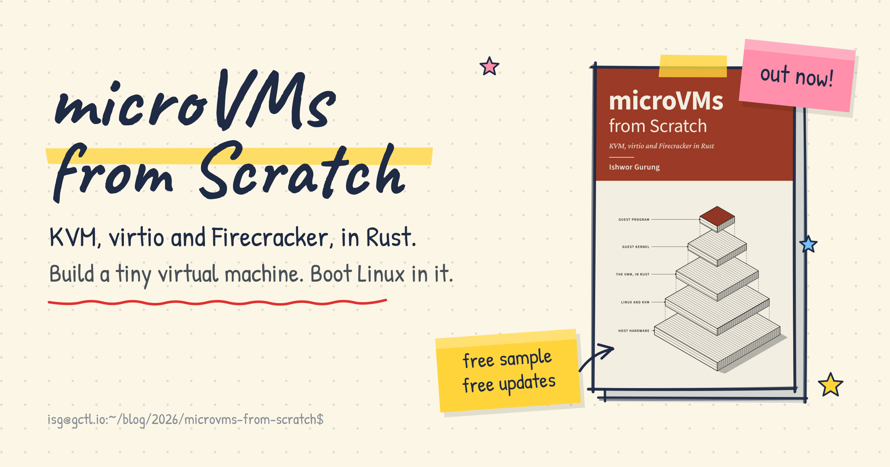

<figure class="post-figure">
  
</figure>

My book is out! 🎉 It is called **[microVMs from Scratch: KVM, virtio and Firecracker in Rust](https://leanpub.com/microvm-book)**, and you can get it on Leanpub today.

If you have ever called an AWS Lambda function, a tiny virtual machine started, ran your code and was thrown away. That small machine is a *microVM*. The book is about how one works, and you learn it the slow, honest way: by building one.

## 🤔 Why I wrote it

I kept running into the same wall. The pieces of this subject are all out there, and many of them are excellent: [Intel's manuals](https://cdrdv2.intel.com/v1/dl/getContent/671200) for the CPU, the [kernel's KVM documentation](https://docs.kernel.org/virt/kvm/index.html), the [virtio specification](https://docs.oasis-open.org/virtio/virtio/v1.2/virtio-v1.2.html), and the source of [Firecracker](https://github.com/firecracker-microvm/firecracker) and [Cloud Hypervisor](https://www.cloudhypervisor.org/). Each one answers its own question well.

What I could not find was a book that *glued them together*. Something that starts at the CPU and walks, in one voice and one story, all the way up to a real microVM that boots Linux. Learning it meant joining the pieces myself. So I wrote the book I wish I had been handed at the start.

## 🧭 What is in it

The book climbs one layer at a time. Each chapter explains the idea it needs, in plain words, and then uses it.

<figure class="post-figure">
  
  <figcaption>Five chapters, from the CPU up to the VMMs that run in production.</figcaption>
</figure>

1. **The CPU.** What a virtual machine is at the level of the chip, and how Intel's hardware support (VT-x) made it fast.
2. **KVM, from Rust.** How a normal Linux program asks the kernel for a virtual machine, and runs a few bytes of code inside it.
3. **Booting Linux.** Getting a real kernel to start inside your own little machine and give you a shell.
4. **virtio.** Giving that machine a disk and a network card, the way real microVMs do.
5. **Production.** A tour of how Firecracker and Cloud Hypervisor are built, mapped back onto the small one you wrote.

A few words, in case they are new. A **VMM** (virtual machine monitor) is the program that runs a virtual machine. **[KVM](https://linux-kvm.org/)** is the part of Linux that lets an ordinary program do that. **virtio** is the common way a guest and its host share fast devices. **[Firecracker](https://firecracker-microvm.github.io/)** is the microVM monitor behind [Lambda](https://aws.amazon.com/blogs/aws/firecracker-lightweight-virtualization-for-serverless-computing/). The book explains each of them from scratch, so you do not need to know them yet.

It is written for software engineers who have *not* done systems programming. If you have used Docker or a cloud VM and you are curious what is underneath, that is you. To follow along you need a Linux computer on an x86-64 chip, and from chapter 2 on, access to `/dev/kvm`. The book shows you how to check.

## 🔗 The code is open

Everything you build in the book is in a public repository, so you can read it, run it and change it: **[microvm-book-source](https://github.com/ishworgurung/microvm-book-source)** (MIT licence). The book itself is the paid part. It is the story that connects the code, and the reasons behind every step.

If you read my post on [cocoon](), which runs Claude Code inside a tiny VM on Cloud Hypervisor, this is the book about what is going on underneath it.

## 🔄 A live edition

A book about this subject goes stale fast. Firecracker and Cloud Hypervisor release new versions, the Rust libraries change, and Linux keeps moving. A frozen book would slowly stop matching what you see on your own screen.

So I am treating this one as a *live edition*. My plan is to keep going back: re-run the code, check it against newer versions, fix what I got wrong, add what changed and cut what has aged. Leanpub makes this easy, because everyone who has the book gets the new versions for free.

<figure class="post-figure">
  
  <figcaption>The loop I plan to keep running. It is a plan and an intention, not a timetable.</figcaption>
</figure>

This is the second edition, from November 2026. It is a fast-iterated cut of the first, and I would rather ship and keep improving than wait for perfect. It will still have mistakes. If you find one, or something is unclear, or a section should go deeper, please tell me. The Leanpub page has a way to contact me, and your notes feed straight into the next revision.

## 📚 Where to go next

- 📖 **The book:** [leanpub.com/microvm-book](https://leanpub.com/microvm-book). There is a **free sample** on the page, so you can try the style before you buy, and Leanpub offers a 60-day money-back guarantee.
- 💻 **The code:** [github.com/ishworgurung/microvm-book-source](https://github.com/ishworgurung/microvm-book-source).

Thank you for reading, and if you build a microVM of your own, I would love to hear how it went.

> Point-in-time (21 November 2026): second edition, as listed on Leanpub today. The price, the formats and Leanpub's terms are theirs and can change, so check the book's page for the current details.
